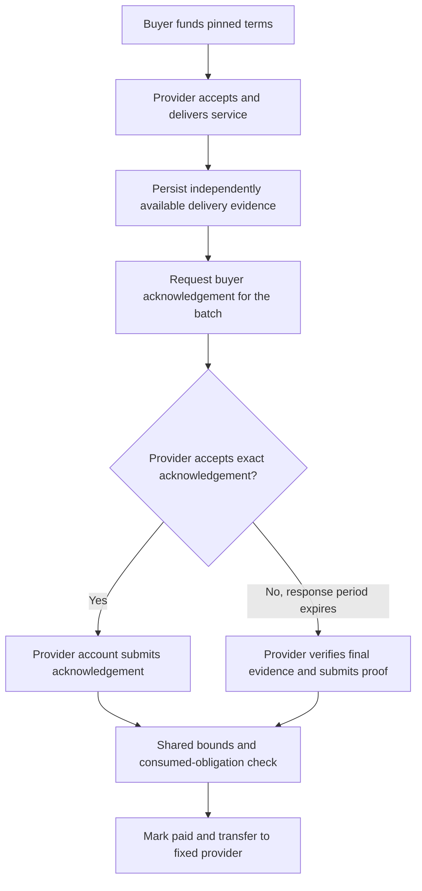

# Rent dispute mechanism

Status: draft specification, 3 Nov 2026. No implementation of this mode exists.
The owner requested the two payment paths. This document proposes their exact scope.
The settlement unit and independent evidence authority remain assumptions for review.

The owner named this flow the **dispute mechanism**.
Normal settlement uses the buyer's acknowledgement. The dispute path uses a delivery proof after the response period.
"Fallback" in the technical sections means this proof-based dispute path.
Buyer silence makes that path available; it is not evidence of delivery or an admission of fault.
Resolution follows the funded policy and verified evidence. This version adds no human arbitrator or appeal process.
It is not the referee dispute of the pocc integration specification, section 8 (pocc decision 20), which stays deferred.

Base inspected: policy-execution `e4b8ac8` (includes PR #76).
Companion: pocc `docs/handoff/dispute-mechanism.md`, based on PR #1 at `110d813`.
This proposal amends [PE-0](04-rent-interface-v1.md), not existing funded orders.
PE-0 remains the specification of the previous proof-only rent mode.

## 1. Result of the correctness review

The requested flow is sound under four conditions:

1. Funding authorizes the fallback delivery policy before service starts.
2. A proof can establish that policy without the missing buyer acknowledgement.
3. Both settlement paths require provider consent and enforce timing, limits and one shared replay check.
4. Refunds remain unavailable until the provider's proof settlement deadline passes.

Silence is not evidence of delivery. Timeout only enables the proof path.
A proof establishes the programmed checks over authenticated inputs. It cannot establish an unauthenticated physical fact.

The current rent specification fails condition 2 for a completely silent buyer.
It requires buyer-signed hourly notes and buyer-controlled meter signatures.
The existing task guest also verifies `acceptance_signature` in `core::authorize`.
Moving those checks into Solidity, as decision 46 proposes, does not remove this dependency.

There are two distinct products:

| Product | What happens when the buyer is silent? |
|---|---|
| Add a final release signature but retain all existing hourly evidence | Proof works if the provider already holds the required notes and meter signatures. It cannot recover a missing last note. |
| Pay for delivered service despite refusal to sign its receipt | Requires an independent delivery witness and a new rent decision that does not require that receipt. This is the proposed mode below. |

## 2. Scope and assumptions

The proposed mode is `buyer_ack_or_delivery_proof`.
It is an explicit exception to rent's earlier proof-only settlement choice.
It does not restore signature settlement for every framework case.

**Assumption A: preserve existing rent batches.** Each payment releases the amount for one completed service batch.
VM creation alone does not release the remaining lease balance or pay for future hours.
For payment per completed hour, use `batch_size = 1`.
Payment of the full escrow on VM handover is a different, fixed-delivery product.
That product needs a handover predicate and an explicit transfer-of-control test before this specification can cover it.

**Assumption B: a meter agreed by both parties supplies fallback evidence.** The buyer records the proposed meter key before funding.
Before calling `accept`, the provider must approve that meter, its delivery predicate, evidence access and retention commitments.
The provider's acceptance binds the funded policy and meter configuration. Otherwise it must refuse the order.
Neither the buyer nor the provider can replace that key after acceptance.
A different key held by the same buyer is not an independent meter.
The provider must be able to obtain the signed evidence without a new buyer action.

Settlement trusts the meter's signature. A dishonest meter can attest false delivery, and the proof checks the attestation and the policy, not the metering.
The meter's output is not opaque, however. Each usage record binds the hash of the PoCC receipt that it was computed from.
The PoCC verifier is deterministic, and the provider runs it for each piece. Therefore the provider detects a false or conflicting record at once.
Anyone can refute such a record later by running the verifier on the kept receipt.
Detection is not enforcement: the escrow pays on the signature, and this version has no referee or clawback.
While the development anchor is in use, a refutation also rests on the notary's anchor key.
Enforcement in the guest is X-1 (below). See [lease evidence 5a.4](../product/lease-evidence.md#5a4-the-first-meter-pocc).

The PoCC agent runs inside the buyer's machine. The buyer can stop it, block it, or read its key.
The buyer cannot remove anchored evidence: the notary keeps the first entry for each agent and sequence number, and the provider stores every anchored entry (lease evidence SS-13).
Therefore a hostile buyer can stop future evidence only. The provider's liveness watch (SS-12) then stops the machine after `liveness_miss_slots` slots.
With the extracted key, the buyer can also submit a signed but malformed heartbeat. The notary accepts it, and a receipt that includes it is `INVALID`.
The provider therefore checks each entry's contents, keeps the last valid receipt prefix, builds records from that prefix only, and stops on a failed entry (SS-12, SS-13).
The fallback pays only for billing-eligible pieces, and inside them only for time with valid anchored heartbeats. Time after the agent stopped is never paid.
The listing must state this rule. A sidecar that the buyer cannot stop, and an observer, are research for a later improvement (pocc decision 47 and `docs/research-sidecar-observer.md` in `mnemonik-xyz/pocc`).

PoCC Stage 0 also retains its physical-machine and sampled-liveness limitations.
It does not establish allocated GPU resources, performance, or successful access by the customer.
The listing must identify the exact delivery predicate and those limits.

An alternative is X-1: run the delivery verifier inside the guest over authenticated witnesses.
That alternative needs authenticated beacon, anchor and provider evidence. It is not implemented by this proposal.
Neither independent metering nor X-1 is treated as an already approved business choice.

## 3. Existing code and what can be reused

Source inspection and local verification: 3 Nov 2026.

| Component | Existing evidence | Reuse and remaining work |
|---|---|---|
| `contracts/src/InvoiceEscrow.sol` | `settle`, `settleSigned`, `_authorize`, `_pay`, `close` | Reuse the common authorization/payment structure. Its invoice schema, price threshold and signer allowance are not this rent protocol. |
| Same contract | Both paths use `consumed[customer][obligation]` and `spent` | Preserve cross-path exclusion, with provider consent for acknowledgement. Its map is contract-local; cross-deployment replay still needs the factory registry. |
| `host/src/signer.rs` | Buyer service checks policy and live order before signing | Reuse the pattern, not the invoice decoder or its field offsets. |
| `core/src/evidence.rs` | `signer_digest`, `sign_journal`, recoverable signatures | Reuse cryptographic primitives. Rent needs a separate domain and fixtures. |
| `methods/*-guest`, receipt verification infrastructure | Existing task, invoice and solver proof paths | Reuse build/prove/wrap/verify machinery. There is no `core/src/rent.rs` or implemented `WarrantEscrow` at the inspected base. |
| pocc `pkg/verify`, `pkg/adapter/warrant` | Delivery checks, record persistence, signing bridge, gate reference | Reuse record production and storage. The current signer is buyer-controlled. |
| pocc `pkg/lease` | Continuation, reservations, timeout, stop, batch closure | Extend its accounting. Today a missing note becomes loss, not a pending proof claim. |
| Decision 46 | Proposed stateless Solidity signature verifier | Not implemented at these bases. Its buyer-note requirement is unsuitable for the no-acknowledgement fallback. |

Checks run against these bases:

- `forge test --match-contract InvoiceEscrowTest`: 30 passed, including two fuzz tests with 256 runs each.
- `go test ./pkg/lease ./pkg/adapter/warrant`: both packages passed.
- The contract tests use a test journal verifier. They do not establish a real rent proof or a deployed fallback.

Review correction, 3 Nov: shared replay protection does not protect a provider against an underpaid settlement submitted by the buyer.
The draft previously allowed that attack. Section 6 now requires provider consent before acknowledgement can consume an obligation or establish a cutoff.
A separate reproduction against `InvoiceEscrow.settleApproved` paid one unit, blocked a 1,000-unit authorization, then refunded the remainder.
That reproduction used the test verifier. The legacy invoice flaw remains separate work; do not copy its customer-only approval semantics.

## 4. Flow



Only the funded recipient account can call either settlement entry point in this version.
The recipient always comes from the funded order. A third party can supply a proof but cannot submit settlement directly.
Signing alone does not move funds. A valid settlement transaction must be included on chain.
Acknowledgement remains usable after the response period, until settlement expires.
The first fully authorized settlement wins. The other path must revert without another transfer.
An unaccepted buyer signature cannot reserve, consume, close or otherwise modify an obligation.

The provider can prepare witness data early. The default worker starts costly proving after the response period.
The contract cannot observe when proving started. It enforces when proof settlement becomes valid.

## 5. Terms, timing and deployment binding

Use a new policy version, journal schema and guest image for this mode.
Proposed schema name: `warrant/journal/rent-ack-proof/v1`.
Do not accept an old rent or invoice journal under this schema.
The deployment pins the image and schema. All orders on it use this mode.

Keep the existing scope, recipient, customer, lease, period, price, floors and ceiling fields.
Add `ack_timeout_s > 0`. It is distinct from the hourly `challenge_timeout_s`.
Keep `settlement_margin_s = M > 0`, now measured for the actual fallback guest.
The acknowledgement signer in this first version is the funding customer account.
Delegated signer allowances and revocation are outside this version.

The contract must store the schedule, batch size and per-piece cap needed for both paths.
Those values must also be bound to the proved policy.
Define `settlementTermsHash = sha256(abi.encode(...))` over the following ordered, explicitly typed values:

```text
uint64 policyVersion, address customer, address recipient, bytes32 leaseId,
uint64 ceiling, uint64 maxPerPiece, uint64 serviceStart, uint64 serviceEnd,
uint64 pieceS, uint32 batchSize, uint64 ackTimeoutS, uint64 settlementMarginS,
uint64 acceptBy, uint64 settleBy, bytes32 deliverySpecHash
```

Scope and `policyHash` remain separately checked journal fields.
The customer is `msg.sender` at funding. It is not supplied by a relayer.
The guest recomputes this hash from its policy and order witness; the contract compares it with its stored terms.
Order-only `acceptBy` and `settleBy` come from that witness and must satisfy policy constraints.
Every multiplication, addition, index conversion and subtraction must be checked.
Reject invalid schedules, overflowing deadlines and policy amounts above the existing supported bounds.
Require `piece_s > 0`, `service_end > service_start`, and `(service_end - service_start) % piece_s == 0` before division.
Require `service_start % piece_s == 0` and a positive batch size within the supported maximum.
The piece count and every index must fit their declared types without truncation.

For scheduled batch `b`, define:

```text
pieces = (service_end - service_start) / piece_s
first(b) = b * batch_size
last(b) = min(first(b) + batch_size, pieces) - 1
batch_end(b) = service_start + (last(b) + 1) * piece_s
proof_after(b) = batch_end(b) + ack_timeout_s
deadline(b) = proof_after(b) + settlement_margin_s
```

The contract derives these values. A provider timestamp cannot start or shorten the response period.
Validate `first(b) < pieces` before subtraction.
For a full batch, acknowledgement settlement requires `now >= batch_end(b)`.
Proof settlement requires `now >= proof_after(b)`.
Both require `now <= deadline(b)` and `now <= settleBy`, plus the journal validity window.
Refund requires `now > settleBy`. Equality therefore permits settlement and refuses refund.
Policy validity and seller credentials must cover the applicable proof deadline.

For a final partial batch, the acknowledgement can settle after its last completed piece.
Its proof still waits until the scheduled `proof_after(b)`.
This fixed schedule avoids an on-chain claim-registration transaction and an unauthenticated delivery timestamp.
It can delay recovery after early termination. Use smaller batches if that delay is unacceptable.
The response period is a pre-agreed schedule, not proof that an off-chain notification reached the buyer.
Workers must publish and retry notifications; late evidence does not extend the deadline automatically.

Set `settleBy >= deadline(last scheduled batch)`. Stop service before accepting liabilities that cannot fit this budget.
Measure M from evidence acquisition, queueing, proving, wrapping, submission, inclusion and finality under load.
No CPU/GPU estimate or existing 1,800-second placeholder is a measured value for this new mode.

## 6. Claim, acknowledgement and shared checks

Keep PE-0's fifteen header words. Replace its five-word extension with these eight words, in order:

```text
leaseId, batch, batchSize, ceiling, customer,
firstIndex, pieceCount, settlementTermsHash
```

This is a 23-word journal. Golden fixtures must fix every word's ABI type and range before implementation is frozen.
`firstIndex` must equal `first(batch)`.
`pieceCount` is positive and cannot exceed that batch's scheduled piece count.
The claim covers that exact contiguous prefix, including zero-priced outage pieces.
`deliveryHash` binds the ordered records and the closure/billing eligibility evidence.
No arbitrary caller-selected obligation identifier is accepted.
Derive `obligationId` from the existing `(leaseId, batch)` identifier rule.
Do not add the authenticator or the new schema to the replay identifier.

For this schema, `deliverableHash` equals `deliveryHash`; it no longer hashes buyer note identifiers.
`evidenceHash` commits the checker version, credential, records and independent eligibility/closure statements.
`validAfter` is at least the end of the claimed completed prefix and the policy/credential validity starts.
`validUntil` is at most the batch deadline and the policy/credential/evidence validity ends.
The guest rejects an empty intersection. The contract checks these bounds using its stored schedule and terms.
The additional proof delay remains a contract check; it does not prevent an earlier acknowledged settlement.

The acknowledgement signs this claim through EIP-712:

```text
Domain: name = "Warrant Rent", version = "1",
        chainId = block.chainid, verifyingContract = address(this)
Type: RentAcknowledgement(bytes32 orderId,bytes32 journalHash)
journalHash = sha256(exact journal bytes)
```

The wallet must display recipient, token, amount, service range and the fact that the signature authorizes payment.
It must display that the batch closes once, including any forfeited suffix of a final partial batch.
Never label this only a login, receipt download, or harmless confirmation of VM creation.

EOA signatures use a standard checked recovery implementation: reject malformed length, high-s and zero recovery.
Smart-account customers use ERC-1271 and must return the specified magic value through a static call.
The signature is checked at settlement time. Smart-account signature validity can change.
Neither signer unavailability nor invalidation disables the independent proof path.
EIP-712 domain separation does not replace the consumed-obligation check.

Proposed entry points:

```solidity
function settleAcknowledged(bytes calldata journal, bytes calldata buyerSignature) external;
function settleProven(bytes calldata seal, bytes calldata journal) external;
```

### 6.1 Provider consent is a contract check

For both `settleAcknowledged` and `settleProven`, require `msg.sender == order.recipient` from the stored, validated order.
Reject the customer, a third-party relayer, and any other caller unless that caller is also the funded recipient.
Do not use `tx.origin`, a caller-supplied provider address or untrusted forwarded-sender data.
The requirement is identical for positive, reduced and zero amounts, and for full or partial batches.

The provider's transaction accepts the exact journal in its calldata on either path.
That consent includes the amount, service prefix, evidence commitments, final cutoff and one-time closure of the whole batch.
A copied buyer signature or copied calldata gives another account no right to submit acknowledgement settlement.
The provider must check these values against its expected claim before sending the transaction.
The worker check prevents accidental acceptance; the contract caller check prevents hostile buyer submissions, including valid lower-value proofs.

A provider contract wallet must invoke the escrow through its own authorized execution path.
An operator EOA which is not the recipient cannot call the entry point directly.
Do not configure a permissionless forwarding contract as the provider account.

A buyer signature is a payment offer until the provider submits it.
Invalid or rejected offers do not restart the response period, change the cutoff, consume a batch or disable proof settlement.
The proof path requires provider submission plus verification against the pinned guest.
The provider caller cannot replace evidence verification, and a valid proof cannot replace provider consent to close the claim.
Possession of the witness, proof or journal does not grant settlement authority.
This prevents another party from racing a different valid claim against the provider's preferred claim.

Direct third-party settlement is deferred on both paths. Adding it requires a separately reviewed provider countersignature over the exact claim and settlement path.
That future design must use a distinct provider-consent signing type and bind the order, journal hash, domain and expiry.
It must not make the current caller check optional based on an empty signature.
Provider account unavailability can delay either path until expiry. Operate that account with its own authorized recovery or execution arrangements.
Do not add an emergency permissionless settlement bypass: it would restore the proof race.

### 6.2 Shared authorization and payment

Both paths must call the same authorization and payment routines:

1. Check schema, journal length, canonical word encoding and order existence.
2. Require state Accepted and exact customer, policy, scope, recipient, lease, ceiling and terms hash.
3. Check schedule, batch partition, contiguous prefix, per-batch cap and time limits.
4. Require `amount <= pieceCount * maxPerPiece` and `spent + amount <= ceiling`.
5. Require the provider caller on both paths. Also verify the customer signature for acknowledgement, or the pinned image and exact journal hash for proof.
6. Atomically consume the same factory-registry obligation, update spend, then transfer the exact amount.

Use checks-effects-interactions and reentrancy protection for every settlement and refund entry point.
Reverts must roll back consumption and spend. A zero-amount outage batch closes without an ERC-20 transfer.
A zero-amount acknowledgement still needs provider consent. A zero-amount proof must establish the policy-derived zero entitlement.
Keep the batch partition pinned across all deployments and policy versions for a customer and lease.
Retain the shared factory registry when changing images or settlement modes.
The shared terminal-cutoff state is a new registry requirement alongside partition and consumption.
Deploy this mode for fresh funded leases. Do not reinterpret existing orders or concurrently fund the same lease in legacy escrows without shared replay state.

A partial-prefix settlement closes the whole batch. There is no later top-up for its suffix.
It is allowed only as a final batch of a stopped lease.
The acknowledgement path obtains both parties' agreement to that final prefix through the buyer signature and provider transaction.
It does not independently prove physical shutdown. The provider must stop service before accepting a terminal cutoff.
The proof path instead requires the guest-authenticated final stop and billing-eligibility statement.
Record that terminal cutoff in shared lease state; both paths refuse later pieces beyond it.
Previously completed earlier batches remain payable until their own deadlines.
Concurrent settlement must enforce one consistent cutoff. A new lease needs a new lease identifier.
The registry must also track the highest settled index. A new cutoff cannot invalidate already settled later pieces.

**Fast-path trust:** the buyer signature authorizes payment, and the provider transaction accepts its amount and closure terms.
The contract does not execute the rule tree or independently check physical delivery on that path.
A compromised buyer account can offer payment within these bounds; the provider must accept before it settles.
An explicitly accepted reduced amount is final. The provider cannot later prove a top-up for the consumed obligation.
This is different from the previous proof-only guarantee and must be explicit in the funded terms.

## 7. Dispute evidence and guest changes

Funding is the buyer's advance authorization to pay amounts calculated by the delivery policy.
The provider does not need a new acceptance signature for a piece after its delivery.
Do not create a dummy `Acceptance`, set `accepted = true`, or skip that check in the old guest.
Create a versioned rent input and explicit delivery-based authorization semantics.

The fallback input contains the typed policy, order terms, seller credential, records and independent meter evidence.
It also contains authenticated billing eligibility and any final stop boundary.
The meter must bind scope, policy, lease, batch, record hashes, eligible prefix and stop boundary in its signed statement.
The statement must bind the meter specification and the service period.
Freeze this statement's exact type, tag and encodings with shared fixtures before building an independent signer.

Billing eligibility is necessary because a running provisional piece is not automatically billable under the existing continuation gate.
The independent meter must observe and durably record continuation acknowledgements and stopping events as they occur.
It cannot accept an unauthenticated provider assertion that a provisional piece became billable.
For a trust-free alternative, those events need authenticated witnesses checked inside the guest.
This protocol witness is a new integration requirement, not an existing PoCC record field.

### 7.1 Final evidence and non-revision

An interim measurement is not a payable record. An eligibility snapshot is not a final batch statement.
Use distinct signed types and tags for interim observations, final usage records, final batch statements and terminal stop statements.
The finality marker and all identifiers must be inside the signed message, not a host-supplied flag.
Freeze these types, tags and canonical encodings in the shared fixtures before implementing the meter.

Within the accepted policy scope, the meter must enforce these durable uniqueness keys:

- `(lease_id, index)`: at most one final usage-record content, including units and evidence hash.
- `(lease_id, batch)`: at most one final batch-statement content, including the eligible prefix and ordered final-record hashes.
- `lease_id`: at most one terminal stop-statement content, including the final billable cutoff.

Persist each final content commitment atomically before signing or returning it. Retries return that same content.
Multiple signature encodings or zkVM proof representations are not different entitlements; uniqueness applies to the committed content.
The meter cannot replace final records with lower or higher unit counts, or issue a later revision of a final stop boundary.
Recovery after a crash must retain these commitments. A replacement key or restarted service cannot reset them for an accepted lease.

Finalize a usage record only after its piece ends and the policy's evidence-completion/finality rule is satisfied.
Finalize a batch only after its scheduled end, or after a unique terminal stop statement establishes an earlier final prefix.
Include every scheduled piece of a normal batch, including zero-unit outages. Refuse interim or incomplete eligibility snapshots.
For an early final batch, include every eligible completed piece through the terminal cutoff; never an arbitrary shorter prefix.
The final batch statement must bind the terminal statement's hash when it closes a lease early.
The meter must not finalize billable pieces beyond a terminal cutoff.

The guest requires the full scheduled batch unless the authenticated terminal statement fixes its final eligible prefix.
It checks exact record coverage, the finality type, and all cross-bindings. It must reject contradictory statements presented together.
It must reject a short prefix presented as an ordinary non-final batch, even when every included signature is valid.
The worker compares the final statement with its persisted records and expected claim before requesting either settlement.
If it observes conflicting final statements, it must retain them and stop automatic settlement and continued service.
It must not resolve a conflict by choosing the first, cheapest, highest-value or newest signed statement.
It must run the PoCC verifier on the receipt that each conflicting statement binds.
A statement that does not follow from its receipt is the meter's fault. Record that result with both statements for the parties and for a later dispute design.
This identifies the fault. It does not authorize a payment or replace the missing final statement.

When the liveness watch (lease evidence SS-12) stops the lease, the terminal stop statement must record that stop.
Its cutoff comes from authenticated billing eligibility: the last piece that passed the continuation gate.
Heartbeats measure delivery inside eligible pieces only. A provisional next piece with valid heartbeats is not eligible and never moves the cutoff.

These rules constrain an honest meter and detect conflicts which are supplied or observed.
A guest cannot prove that a trusted meter never signed an undisclosed conflicting statement elsewhere.
Therefore finality rules do not replace the provider caller check, nor do they remove the trusted-meter assumption.
Correcting a finalized metering error requires explicit recovery work; this version has no automatic revision or arbitration path.
Keep the reservation Held until an authorized outcome or the existing expiry/loss rules apply.

### 7.2 Guest decision

The guest must:

- Validate the policy and its hash, order terms, credential, scope, period and pinned evidence authority.
- Authenticate final records and final batch/terminal statements under section 7.1; reject a buyer-only meter configuration for this fallback profile.
- Enforce lease-wide indices, exact windows within `service_end`, meter specification and canonical record hashes.
- Recompute creditable limits from the agreed schedule or check the approved meter's schedule-bound attestation.
- Require `units <= creditable`, valid assurance, checked arithmetic and all mandatory delivery gates.
- Compute each amount as `units * price_per_unit`, or zero when coverage or assurance is below its floor.
- Require each amount within `maxPerPiece`; use zero tolerance in this first mode.
- Include every eligible piece in order, including zero pieces, then sum amounts with checked arithmetic.
- Derive the request amount and evidence commitments; do not trust a provider-supplied total.
- Evaluate the rent rule tree with delivery-derived facts. Reject policies requiring a fresh buyer `Accepted` fact on fallback.
- Commit the new journal, including the terms hash and the exact closed prefix.

The proof cannot establish more than its evidence model permits.
Provider-controlled telemetry without an approved independent authority is insufficient for this pilot profile.
Distinct key bytes do not prove independent ownership. Independence is a disclosed operational assumption checked when both parties accept the listing.
The seller credential and meter evidence must remain available without the buyer after service delivery.
Withheld or invalid evidence results in no proof payment. Expiry is not an alternative authorization.

For the first implementation, verify independent meter signatures inside the guest.
Decision 46's Solidity verification is an optional later optimization with a separate schema and integration test.
Do not reuse its existing record-plus-buyer-note facts layout for a fallback which has no buyer notes.

## 8. Service state and reservations

Provisioning, hourly metering, the continuation timeout and resource shutdown remain operationally unchanged.
Hourly continuation messages are distinct from the batch settlement acknowledgement.
If the buyer stops responding, stop the machine under the existing exposure policy.
The new fallback can recover eligible completed service; it does not authorize unlimited continued provisioning.
The provider also watches the agent every slot (lease evidence SS-12) and stores every anchored entry (SS-13).
After `liveness_miss_slots` slots without an anchored heartbeat, or an early final heartbeat, stop the machine.
Keep `liveness_miss_slots × 60 s ≤ challenge_timeout_s`, so that the existing exposure bound `E` still applies.

Missing settlement acknowledgement changes payment status, not the amount of collateral available.
Use reservation categories with explicit meanings:

| Category | Meaning |
|---|---|
| Open | Reserved service which is running or awaiting classification |
| Held | Eligible delivered service awaiting either settlement path, including proof work |
| Settled | Finalized payment |
| Lost | A terminal unrecoverable reservation under the existing bounded accounting |
| Unresolved | Accounting that could not enter Lost because its bound was reached |

On timeout, move eligible completed service from Open to Held, not Lost.
Keep provisional unbillable service separate; it remains provider exposure.
Acknowledge and prove operate on the same Held reservation. They must not create separate reservations.
Do not free Held collateral merely because a proof failed or another path is in flight.
Release it only after final settlement or final expiry/loss classification.
Reorgs and uncertain submissions require reconciliation before a second action changes accounting.
Preserve checked sums, the ceiling invariant and the existing Lost/Unresolved overflow behavior.

## 9. Acceptance tests and deployment gates

| Test | Required result |
|---|---|
| Valid buyer acknowledgement submitted by the provider, no proof | Pays once; emits acknowledgement authenticator |
| Buyer submits zero or one-unit acknowledgement while full delivery is owed | Revert Unauthorized; consumed, spent and cutoff unchanged; later full proof still pays |
| Buyer submits a one-piece final prefix while later delivered batches remain unpaid | Revert Unauthorized; no terminal cutoff; all valid proof claims remain available |
| Third party copies a valid buyer signature and transaction calldata | Acknowledgement submission reverts; no provider consent is inferred |
| Provider submits an invalid buyer signature or changes the signed amount/prefix | Revert without state changes |
| Provider explicitly accepts a zero or reduced amount | Close once under both parties' authority; no later top-up |
| Provider contract wallet executes through its authorized path | Accepted; unrelated operator direct calls and buyer forwarding fail |
| Provider submits a valid proof after timeout | Pays the fixed recipient, subject to all common checks |
| Buyer or third party submits any valid proof, including a lower-value claim | Revert Unauthorized; consumption, spend and cutoff unchanged |
| Non-recipient submits a valid proof with an earlier final prefix | Revert Unauthorized; later unpaid claims remain available |
| Another account copies the provider's proof and calldata | Revert Unauthorized; copied evidence is not provider consent |
| Provider caller supplies an invalid proof | Revert; caller authority cannot replace proof verification |
| No buyer signature after funding, first piece delivered | Independent meter evidence can settle after timeout |
| Buyer-only evidence withheld | Explicitly no payment; not advertised as a working independent fallback |
| Valid proof just before / exactly at `proof_after` | Revert / eligible |
| Both paths at `deadline`; refund at `settleBy` | Settlement allowed subject to other checks; refund refused |
| Both paths after deadline | Revert; remaining funds refundable only after `settleBy` |
| Acknowledgement then proof; proof then acknowledgement | Second payment reverts in either order |
| Same obligation, changed amount or evidence | Still one payment; hash changes cannot bypass consumption |
| Wrong signer, chain, escrow, customer, recipient, policy, schema or image | Revert |
| Invalid ERC-1271 magic value, malformed EOA signature | Revert |
| Mutated timing terms or provider-supplied early timestamp | Revert |
| Boot record only, future service, provisional piece or unproved handover | Cannot claim completed eligible service |
| Outage, wrong hardware assurance, missing records or gaps | Zero or denial according to the pinned policy; no hidden skip |
| Final partial prefix, later suffix, later batch, concurrent cutoff | One consistent terminal cutoff; no suffix top-up |
| New image or escrow, same customer and lease | Shared partition and replay history still prevent duplicate payment |
| Forged meter record or forged billing eligibility | Deny |
| Proof queue failure, retry, buyer acknowledgement during proof | No duplicate reservation or payment |
| Transfer failure, reentrant token, zero payout | Atomic rollback / rejection / closure without transfer |
| Rejected underpayment offers are repeated through the deadline | No clock reset or state changes; proof path remains usable |
| Non-divisible service period, zero piece size or overflowing index | Policy/order rejected before service starts |
| Meter retries a finalized record after restart | Same committed content; attempts to change units or evidence hash refused |
| Meter attempts two final batch statements with different prefixes | Durable finalization refuses the second; worker stops on observed conflicting signatures |
| Interim eligibility statement or interim usage record used in a proof | Guest rejects regardless of signature validity |
| Short non-final batch without terminal statement, or prefix shorter than its terminal cutoff | Guest rejects |
| Terminal statement revised, duplicated inconsistently or paired with a mismatched final batch | Meter refuses revision; guest rejects supplied contradictions; worker stops on observed conflict |
| Full scheduled batch with zero-unit outage records | Includes every index; final claim can settle by provider submission |
| Buyer stops the agent or blocks its network in the middle of a batch | Provider stops within `liveness_miss_slots` slots plus shutdown latency; anchored earlier pieces remain payable by proof; later time unpaid |
| Buyer reads the agent key and signs a different entry for an anchored sequence number | Notary refuses it; anchored evidence and the proof claim do not change |
| Buyer signs an early final heartbeat with the extracted key | Credit ends there; provider stops; terminal stop statement records the cutoff |
| Buyer signs a malformed heartbeat after a valid prefix (wrong round, beacon value or chain link, or an entry after a final heartbeat) | Provider stops at once; the full receipt is `INVALID`; the last valid prefix verifies and gives the same records for completed pieces |
| Next piece runs provisionally with valid heartbeats, continuation never authorized, then shutdown | Cutoff is the last eligible piece; the provisional piece is not paid |
| Meter signs a record that does not follow from its bound receipt | Provider's verifier run detects the mismatch; worker stops automatic settlement and keeps both results |

Both UIs must display any reduced final payment and forfeited suffix before consent.
The provider worker must reject an acknowledgement below its expected amount and use fallback instead.
Only an explicit provider decision can accept a concession. The worker must never submit such an acknowledgement automatically.
The caller check is the security boundary on both paths; possession of a signature or proof is not provider consent.

Require new Rust/Solidity/Go fixtures for terms, journal, acknowledgement and independent meter evidence.
Run real receipt verification and a funded testnet end-to-end run for both paths.
Repeat the no-buyer-response case after deleting access to all buyer signing services.
Run existing lease adversarial tests plus the new transition/race scenarios.
Do not widen the Verus claim beyond the evaluator.

## 10. Cost measurement and implementation order

The normal path avoids zkVM proving. It still pays signature verification and transaction fees.
Let `p` be the fraction of batches settled by proof:

```text
expected cost = (1 - p) * acknowledged_settlement_cost
              + p * (proof_generation_cost + proof_settlement_cost)
              + metering_storage_notification_cost + wasted_race_work
```

Do not charge Groth16 verification to the normal path.
Do not count standalone transaction overhead twice in an integrated settlement estimate.
A hostile buyer can force `p = 1`. Price and provision the service for that case too.
Measure the actual new guest; the old per-note signature cycle totals do not apply unchanged.
The GPU decision remains a capacity/latency decision until this fallback is benchmarked under concurrent load.

Implementation packages:

1. Confirm settlement unit and independent evidence profile; freeze terms, witness and signing fixtures.
2. Implement the rent decision and journal on the framework; retain existing case semantics.
3. Add both escrow entry points, shared checks, shared replay/cutoff state and boundary tests.
4. Adapt the buyer signer and provider worker; extend lease accounting and independent meter custody; add the per-slot liveness watch and evidence custody (SS-12, SS-13).
5. Benchmark fallback proof and both settlement paths; set measured deadlines and batch sizes.
6. Execute both paths on testnet, including races, cancellation, expiry and complete buyer silence.

## 11. Normative external references

Checked 3 Nov 2026:

- [EIP-712](https://eips.ethereum.org/EIPS/eip-712): typed acknowledgement signing and domain separation. Replay prevention is an application responsibility.
- [ERC-1271](https://eips.ethereum.org/EIPS/eip-1271): contract-account signature verification and the required return value.

This is a reviewable change specification, not a frozen wire interface or production approval.
