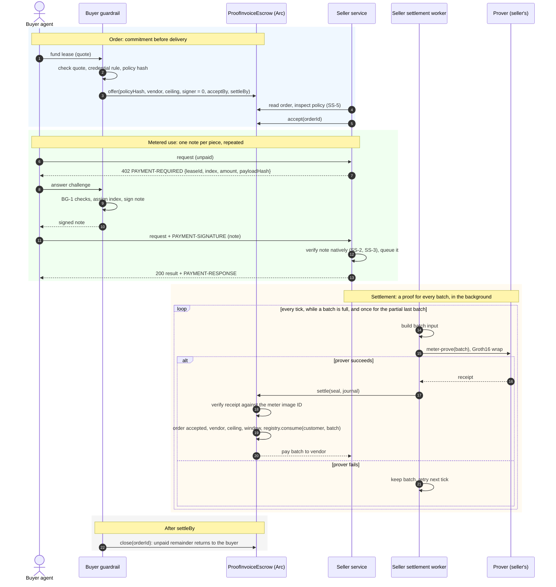

# Specification: the metered payment policy family

Status: **proposed, 2026-10-14. Nothing in this document is implemented.**
Metered payment is a Warrant policy family, beside task, invoice and solver. It is
part of production readiness: track L1 in the [delivery plan](delivery-plan.md) and
an entry in the [policy catalog](policy-catalog.md). The compute marketplace in
[warrant#13](https://github.com/mnemonik-xyz/warrant/pull/13) is its first consumer,
not its owner.

Revision 2026-10-29: the delivery proof. A metered policy must name a meter. The
meter signs a usage record per piece. The guest checks the records before the rule
tree. PoCC (`mnemonik-xyz/pocc`) is the first meter. Section 5a describes it.

Revision 2026-10-14, evening: settlement is by proof for every batch. No signer key
exists in the design. The family deploys on the proof-only escrow and factory of
[policy-execution#19](https://github.com/mnemonik-xyz/policy-execution/pull/19),
which is therefore a dependency of this family. It is not a dependency of the canary.

Abbreviations: GPU — Graphics Processing Unit; VPS — Virtual Private Server;
HTTP — Hypertext Transfer Protocol; API — Application Programming Interface.

## 1. Goal

Pay for any service that is sold in pieces, through the proof-only invoice escrow,
without a contract change and without a design per service. The buyer funds one order
with a ceiling. The buyer then pays per piece with a signed note. The seller settles
notes in batches, each batch with a proof. No key can move the money. Only a receipt
for the pinned meter image over the buyer's own notes can.

The checker does not know what a piece is. A GPU job, an hour of a VPS, a gigabyte,
an API call: the service decides, by the moment it demands a note. The guest, the
escrow and the guardrail are the same for all of them.

Catalog entry: **Metered payment**. Adapter: `meter-proof-v1` on
`ProofInvoiceEscrow.settle`, with the fifteen-word journal, created by
`ProofInvoiceFactory` for the meter image ID. The factory holds the replay history of
every escrow it created, so a later meter image inherits it. Section 11 describes an
optional weaker tier on the plain escrow with a signer. It is not the design.

Why proof for every batch is affordable: the proof is never on the service path. The
service answers against a note in milliseconds. The settlement worker proves a batch
in the background, once per hour or once per day. The cost is prover time per batch,
measured by ME-8, and it sets the batch size.

## 2. The note

A note is the existing `Acceptance` struct, signed by the key the policy names:

| Field | Content |
|---|---|
| `scope` | chain, escrow, token |
| `task_id` | `hash_tagged("warrant/note/v1", (lease_id, index))` |
| `deliverable_hash` | the payload hash the service put in the challenge; the checker never interprets it |
| `recipient` | the seller, equal to the order's vendor |
| `amount` | the price of this piece, at most the per-note cap in the policy |
| `accepted` | true |
| `valid_after`, `valid_until` | the window inside which the note can settle |

Indices start at zero and are consecutive within a lease. The guardrail assigns them.
The existing `warrant_sign_acceptance` tool signs a note today, with a derived `task_id`.

## 3. The 402 challenge

The service demands a note the way every x402 seller demands a payment. An unpaid
request on a metered path returns `402 Payment Required` with the `PAYMENT-REQUIRED`
header. The header carries a Warrant scheme instead of an EIP-3009 transfer:

```json
{
  "x402Version": 2,
  "resource": { "url": "https://<host>/job", "description": "...", "mimeType": "application/json" },
  "accepts": [
    {
      "scheme": "warrant-note",
      "network": "eip155:5042",
      "asset": "0x3600000000000000000000000000000000000000",
      "payTo": "<seller>",
      "amount": "350000",
      "maxTimeoutSeconds": 60,
      "extra": {
        "escrow": "<InvoiceEscrow>",
        "leaseId": "0x…",
        "index": 17,
        "payloadHash": "0x…",
        "validUntil": 1791900000
      }
    }
  ]
}
```

The client answers with `PAYMENT-SIGNATURE` carrying the signed note. The service
verifies it natively, serves the request, and returns `PAYMENT-RESPONSE` with the note
identifier. The service stores the note for settlement.

The metering rule is therefore not prose. The unit of metering is whichever paths
challenge, and for how much. The OpenAPI document records the 402 response on each
metered path, as the [listing specification](https://github.com/mnemonik-xyz/warrant-showcases/blob/main/docs/circle-listing.md) already does for the
quote path.

Whether Circle's review accepts a resource whose metered paths use this scheme is not
established. The quote path keeps the `exact` scheme, so the listing is not at risk.

## 4. The seller settlement worker

Serving never waits for settlement. A worker inside the seller server settles later:

1. Notes accumulate in a queue as the buyer uses the service.
2. On a timer, the worker takes the unsettled notes that fill a batch and builds the batch input.
3. The worker proves the batch: `warrant-host meter-prove`, then the Groth16 wrap. One proof covers the whole batch.
4. The worker calls `settle` with the seal and the journal. The escrow verifies the receipt against the pinned meter image, then checks the order, the ceiling, the deadline and the replay registry.
5. If the prover fails, the worker keeps the batch and retries on the next tick. It never discards a batch.
6. A partial last batch is proved and settled the same way before `settleBy`. The worker stops accepting new notes for a lease when the time left is below its proving and settlement margin.

The worker needs a queue, a timer, a prover and one settlement call. The prover is the
seller's own x86 Docker host from the canary plan, or a rented proving service. The
receipt is checked on chain, so the prover needs no trust. The seller runs it because
the seller wants to be paid. The seller depends on nobody else for settlement: not on
the buyer, not on a signer, not on a third party.

Nothing is disputed in this flow. A batch either verifies or it does not. The contract
pays or refuses by the same rules for every batch. No arbiter, no approval, no key.

## 4a. Process flow



The diagram shows one lease. The metered-use steps repeat once per piece of service.
The settlement steps run in the background and never block a request. The buyer takes
no part in settlement.

## 4b. Components, deployment and ownership

```mermaid
flowchart TB
    subgraph BUYER["Buyer's environment (owned and run by the buyer)"]
        AG["Buyer agent<br/>LLM client, desktop or server<br/>holds no key"]
        GD["Buyer guardrail<br/>MCP sidecar on the buyer's host<br/>holds: wallet key, registry key, note key<br/>no part in settlement"]
        AG -->|answer 402, fund lease| GD
    end

    subgraph SELLER["Seller's environment (owned and run by the seller)"]
        SV["Seller service<br/>HTTP + MCP, public HTTPS host<br/>402 middleware, native note check<br/>holds: payout key"]
        NQ[("Note store<br/>signed notes, batches, settlement state")]
        WK["Settlement worker<br/>background process beside the service<br/>timer, prove, settle, retry"]
        PR["Prover<br/>x86 Docker host, seller's or rented<br/>runs: warrant-host meter-prove, wrap<br/>required, one proof per batch"]
        SV --> NQ --> WK --> PR
    end

    subgraph PROVIDER["Cloud provider (io.net, owned by the provider)"]
        WR["Worker container<br/>GPU job runner<br/>holds: nothing of Warrant"]
    end

    subgraph ARC["Arc (public chain, owned by nobody)"]
        FY["ProofInvoiceFactory<br/>no admin; shared replay registry<br/>for every escrow it created"]
        ES["ProofInvoiceEscrow<br/>no owner, no upgrade, no signer, no approval<br/>pinned meter image ID"]
        VF["RISC Zero verifier"]
        US["USDC"]
        FY -->|createEscrow| ES
        ES -->|consume| FY
        ES --> VF
        ES --> US
    end

    subgraph CIRCLE["Circle (owned by Circle)"]
        DS["Discovery API<br/>lists the seller's quote endpoint"]
        FC["Facilitator Service<br/>settles the quote fee only"]
    end

    subgraph BUILD["policy-execution (owned by the Warrant team)"]
        IMG["Meter guest image<br/>built with RISC0_USE_DOCKER=1<br/>image ID pinned at deployment"]
        HOST["warrant-host binary<br/>same checker on both sides"]
    end

    AG -->|discover| DS
    AG -->|quote fee, x402 exact| FC
    AG -->|requests + notes| SV
    SV -->|jobs| WR
    GD -->|offer, close| ES
    SV -->|accept| ES
    WK -->|settle(seal, journal)| ES
    IMG -.->|image ID| ES
    HOST -.-> GD
    HOST -.-> WK
    HOST -.-> PR
```

| Component | Runs where | Owner | Holds | Trusted for |
|---|---|---|---|---|
| Buyer agent | The buyer's desktop or server | Buyer | No key | Nothing. It proposes. |
| Buyer guardrail | The buyer's host | Buyer | Wallet key, registry key, note key | Funding, note signing under BG-1, closing orders |
| Seller service | A public HTTPS host of the seller | Seller | Payout key | Serving against notes, SS-1 to SS-8 |
| Note store | The seller's host | Seller | Signed notes, settlement state | Liveness of settlement only |
| Settlement worker | A background process on the seller's host | Seller | Access to the note store and the payout key | Settling every batch in time |
| Prover | The seller's x86 Docker host, or a rented proving service | Seller, or a vendor | Batch inputs | Nothing. The receipt is checked on chain. Required for every batch. |
| Worker container | The cloud provider | Provider, rented by the seller | No Warrant key | Nothing. Service quality is outside the protocol. |
| `ProofInvoiceEscrow` | Arc | Nobody. No owner, no upgrade, no signer, no approval. | Reserved USDC per order | Recipient, ceiling, deadline, proof only, one payment per batch |
| `ProofInvoiceFactory` | Arc | Nobody. No admin. | The replay history of every escrow it created | One payment per batch across image migrations |
| RISC Zero verifier | Arc | Nobody | Verifying key | Proof validity |
| Discovery API | Circle | Circle | Listings | Liveness of discovery only |
| Facilitator Service | Circle | Circle | Quote fee settlement | The quote fee only. Never a note or a lease. |
| Meter guest image | Built in `policy-execution`, pinned in the escrow | Warrant team | The checker program | Everything the proof claims |
| `warrant-host` | Buyer's guardrail, seller's worker, seller's prover | Warrant team | The same native checker | Native results equal the guest's |

Three facts follow from the table. No key anywhere can spend the buyer's funds: the
note key authorizes pieces of service, and only a receipt moves money. No component
outside Arc decides who gets paid. The seller depends on nobody for settlement except
its own worker and its own prover.

## 4c. Hardware and other requirements per component

Figures marked "measured" come from `validation-results.md` or the showcase. Figures
marked "unmeasured" are gates, not estimates. ME-8 measures the prover before any
batch size or threshold is chosen.

### Buyer agent

| Requirement | Value |
|---|---|
| Hardware | Any machine that runs the LLM client. No GPU, no key. |
| Software | An MCP client: Claude Desktop, Cursor or a server-side agent. |
| Network | HTTPS to the seller service, to Circle Discovery and, for the quote fee, to the seller's quote endpoint. |
| Keys | None. BG-4. |

### Buyer guardrail

| Requirement | Value |
|---|---|
| Hardware | Any host the buyer's agent runs on. Native note checking is measured at 0.04 s per decision. No always-on requirement: the guardrail is needed only while the agent uses the service. |
| Software | Python 3 with `mcp==2.3.0`, `httpx2`, `eth-account`, `pyyaml`. The `warrant-host` binary built with Rust 1.88.0 from `rzup` and `r0vm 3.0.5` for `meter-evaluate`. |
| Process | The MCP sidecar of the showcase. It answers 402 challenges for the agent. It takes no part in settlement. |
| Network | Outbound only: Arc JSON-RPC for order reads, `offer` and `close`. No inbound endpoint. |
| Keys | Wallet key for `offer` and `close`; registry key; note key. Each in a keystore, never in a config file. The note key is a low-value key bounded by one order's ceiling, and it cannot move money. |
| Clock | NTP. Note windows and `settleBy` are compared with block time. |
| State | The next note index per lease, persisted before a note is signed. A lost index means a reused index and a refused request. |

### Seller service

| Requirement | Value |
|---|---|
| Hardware | One public host. Two CPUs and 2 GiB of memory for the service and the worker together. Disk for the note store, below 1 KiB per note. |
| Software | Python 3 with the showcase dependencies, `uvicorn`, Starlette with the MCP transport, the 402 middleware of section 3, and the `warrant-host` binary for native note checks. |
| Network | A public HTTPS host with a valid TLS certificate and a stable DNS name. Circle health-checks it continuously and drops the listing while it is unreachable. Port 443 inbound. Outbound to Arc JSON-RPC, to the cloud provider's API, and to Circle's Facilitator Service for the quote fee. |
| Keys | The payout key, used for `accept`, for the quote signature, for the seller proof toward Circle, and by the worker for `settle`. In a keystore. |
| Accounts | A cloud provider account with an API key and prefunded credits, bounded per the canary plan. A Circle API key for the Facilitator Service in production; the Arc testnet trial is keyless. |
| Operations | Rate limiting on the public paths, request logs without note bodies (SS-7), a backup of the note store, alerts for approaching `settleBy`, low gas and a proof backlog, per the delivery plan. |

### Seller settlement worker

| Requirement | Value |
|---|---|
| Hardware | Shares the seller host. |
| Software | The `warrant-host` binary for batch inputs and `meter-evaluate`; Arc JSON-RPC access; a local path or a remote call to the prover. |
| Funds | Native USDC on Arc for gas on `settle`. Arc pays gas in USDC. One settlement per batch; the batch size sets the transaction count and the proof count. |
| Clock | NTP. The margin before `settleBy` is measured in block time. |
| State | Per batch: built, signed, submitted, confirmed, or proving. Persisted so that a restart neither double-submits nor loses a batch. |

### Prover

| Requirement | Value |
|---|---|
| Hardware | x86_64 Linux with Docker. The Groth16 wrap runs only in Docker on x86. CPU count and memory: unmeasured for the meter guest. The measured sample for the invoice guest ran on 14 reported CPUs with four Rayon workers and segment exponent 18, used 2,097,152 cycles in eight segments, and took 445.65 s to prove and 79.73 s to wrap. Peak memory was not recorded. |
| Software | Ubuntu, Docker, Rust via `rustup`, `rzup install rust 1.88.0`, `rzup install r0vm 3.0.5`, Foundry. `scripts/prover-vm.sh` installs all of it on a fresh machine. |
| Settings | `RAYON_NUM_THREADS` and `WARRANT_SEGMENT_PO2` between 16 and 20 to keep proving out of swap. `RISC0_DEV_MODE` is rejected. |
| Alternative | A rented proving service. The receipt is verified on chain, so the prover needs no trust. It needs the batch input, which contains the notes and the credential, not the job payloads. |
| Gate | ME-8: one full batch proved and wrapped on this host, with wall time, CPU seconds and peak memory recorded, before the batch size and the threshold are set. |

### Worker container

| Requirement | Value |
|---|---|
| Hardware | One GPU per container, one replica, duration billing. The showcase uses an RTX 4090 class at about 0.35 USD per hour on io.net. |
| Image | `ghcr.io/mnemonik-xyz/transcription:pilot`, about 1.9 GiB compressed, CUDA 12.3 base, `libcublas-12-3` and `libcudnn9-cuda-12` only, `faster-whisper-small` pinned by revision. Deploy by digest, not by tag. |
| Network | One traffic port, 8080, reachable by the seller service. The buyer reaches it through the seller's metered path, not directly. |
| Keys | None of Warrant. The worker never sees a note. |
| Provider | An io.net account, API key, credits, and the hardware and location identifiers discovered through the provider's API, never invented. |

### Arc

| Requirement | Value |
|---|---|
| Networks | Testnet chain 5042002 at `https://rpc.testnet.arc.io`; mainnet chain 5042 at `https://rpc.mainnet.arc.io`. USDC at `0x3600000000000000000000000000000000000000`, six decimals. Native and ERC-20 USDC share one balance. |
| Contracts | `ProofInvoiceFactory`, `ProofInvoiceEscrow` and the RISC Zero verifier deployed by `DeployInvoice.s.sol` with `proofOnly`, Solidity 0.8.28 Cancun, OpenZeppelin 5.6.1, pinned to the meter image ID from a `RISC0_USE_DOCKER=1` build. Available after policy-execution#19 merges. The BN254 precompiles at `0x07` and `0x08` answered correctly on testnet. |
| Funds | Deployer gas; buyer ceiling plus gas; seller gas for `accept` and settlements. Canary amounts first. |
| Keys | Deployer in a Foundry keystore or a hardware wallet. Separate low-value buyer, seller and relayer keys. Mainnet keys never in the team's secrets file, per the canary plan. |
| Probe | Before any order: chain ID, precompiles, USDC decimals, and the code hashes of the deployed verifier and escrow against the build. |

### Circle

| Requirement | Value |
|---|---|
| Discovery | Keyless. The listing needs the public HTTPS quote endpoint, the OpenAPI document, the payout wallet and the form. Manual review. |
| Facilitator Service | Keyless trial on Arc testnet. A Circle API key for production. The seller proof signed by the payout key on every call. Used for the quote fee only. |
| Open point | Acceptance of the `warrant-note` scheme on metered paths is not established. |

### Build and release, `policy-execution`

| Requirement | Value |
|---|---|
| Toolchains | Rust 1.98.1 from `rust-toolchain.toml` for the workspace; `rzup` Rust 1.88.0 and `r0vm 3.0.5` for the guests; Solidity 0.8.28 with Foundry; Python 3 for the scripts; Verus for `verified/verify.py`. |
| Reproducible image | `RISC0_USE_DOCKER=1 RISC0_BUILD_LOCKED=1 cargo build -p warrant-host --release --locked` on an x86 Docker host. Record `meter-image-id`. Local builds differ between machines and must not be deployed. |
| Tests | `cargo test -p warrant-policy --locked`, `forge test`, the showcase unit tests, and the Verus run with mutations. The meter checker adds its gate tests and removed-check experiments. |
| Artefacts | The image ID, the deployment addresses and code hashes, the compiler versions and the GHCR digest in one manifest, with local, testnet and mainnet evidence kept apart. |

## 5. The module

The module `core/src/meter.rs` follows the solver path: mandatory gates first, the rule
tree last. It reuses `Acceptance` as the note, `VendorCredential` as the seller
credential, the existing `verify`, and the fifteen-word journal layout of the invoice
path. Nothing changes in Solidity.

```rust
// core/src/meter.rs
pub const CHECKER_VERSION: u32 = 1;
pub const MAX_BATCH: usize = 256;

pub struct MeterPolicy {
    pub version: u64,
    pub customer: Address,        // the funding buyer, bound into the journal
    pub scope: Scope,             // chain, escrow, token
    pub valid_after: u64,
    pub valid_until: u64,
    pub registry_key: Vec<u8>,    // vouches for the seller; the buyer's own key today
    pub acceptance_key: Vec<u8>,  // signs the notes
    pub checker_version: u32,
    pub lease_id: Hash,           // poId on chain
    pub ceiling: u64,             // poMaxTotal on chain
    pub max_note: u64,            // per-note cap
    pub batch_size: u32,          // notes per obligation
    pub rule: Rule,
}

pub struct MeterInput {
    pub policy: MeterPolicy,
    pub request: Request,         // task_id = obligation, amount = batch total
    pub batch: u32,
    pub vendor: VendorCredential,
    pub vendor_signature: Vec<u8>,
    pub notes: Vec<(Acceptance, Vec<u8>)>,   // note and signature, in index order
}

pub struct MeterAuthorization {
    pub authorization: Authorization,
    pub lease_id: Hash,
    pub ceiling: u64,
    pub customer: Address,
}
// journal(): the 12 base words, then lease_id, ceiling, customer,
// byte for byte the InvoiceAuthorization layout.

pub fn note_id(lease_id: &Hash, index: u32) -> Hash
pub fn obligation_id(lease_id: &Hash, batch: u32) -> Hash
pub fn authorize_meter(input: &MeterInput) -> Result<MeterAuthorization, MeterError>
```

`authorize_meter` checks, in this order:

1. Policy: version, scope, both keys, checker version, ceiling, per-note cap and batch size nonzero, batch size at most `MAX_BATCH`, rule valid with the invoice flag off.
2. Request: scope, recipient nonzero, `task_id` equals `obligation_id(lease_id, batch)`.
3. Credential: scope, recipient equals the request recipient, signature under the registry key.
4. Notes: one to `batch_size` notes, indices exactly `batch * batch_size` upward with no gap, each with scope, `task_id` equal to `note_id`, recipient equal to the request, `accepted` true, amount at most the cap, signature under the acceptance key.
5. Amount: the request amount equals the sum of the note amounts, with no overflow.
6. `deliverable_hash`: the request field equals the hash of the ordered note identifiers.
7. Validity window: the intersection of the policy, credential and all note windows.
8. Facts: amount, category, accepted, deliverable, recipient. Then `evaluate`.
9. Evidence hash over the checker version, the credential and the notes.

Batches are disjoint by construction, because a note index belongs to exactly one
batch. Each batch is one obligation, so each note pays once with no contract change.
The factory's registry keeps that true across escrows of later meter images. Batch
size one is allowed. The module does not know the spent ceiling or whether an earlier
batch was paid. The contract checks both. The module does not know whether the
service ran. The delivery proof of section 5a does: the meter key attests it.

The rest of the delta:

| Piece | Work |
|---|---|
| `methods/meter-guest` | Read `MeterInput`, call `authorize_meter`, commit the journal. Add the name to `build.rs`. |
| Host | `meter-image-id`, `meter-evaluate`, `meter-execute`, `meter-prove`, copied from the solver ones. |
| Fixtures | One meter journal for the Solidity test that mutates all fifteen words. |
| Template | `templates/meter-v1.json` with ceiling, per-note cap and batch size as parameters. |
| Deployment | `DeployInvoice.s.sol` with `proofOnly` and the meter image ID: one factory, one escrow from it. A later meter image gets a new escrow from the same factory. |
| Tests | The positive path, every gate, removed-check mutations. |

## 5a. The delivery proof

A note proves that the buyer agreed to pay for a piece. It does not prove that the
seller delivered the piece. The delivery proof closes that gap. It follows the
framework design (`docs/framework.md`, "Rent computation").

### 5a.1 The delivery section of the policy

Every metered policy must have one `delivery` section. The validator rejects a policy
without one. The section fixes who may attest delivery and what the attestation must
satisfy. Its hash is `deliverySpecHash`. The escrow stores that hash at `offer`.

```json
"delivery": {
  "kind": "signed_usage",
  "meter_key": "<SEC1 compressed secp256k1 key>",
  "unit": 1,
  "price_per_unit": 1100,
  "tolerance": 0,
  "min_uptime_bp": 9500,
  "min_assurance": 0,
  "meter_spec": "<32-byte hash>"
}
```

| Field | Meaning |
|---|---|
| `kind` | `signed_usage`. Other kinds exist for other cases. |
| `meter_key` | The key that signs usage records. The owner approves it. It never comes from the agent or a model. |
| `unit` | What the meter counts. `1` is instance-second, `2` is gpu-second. The table is in `core`. |
| `price_per_unit` | Token base units per unit. |
| `tolerance` | Token base units that a note can exceed `units * price_per_unit`. Zero by default. |
| `min_uptime_bp` | The least share of a window that the record must credit, in basis points. |
| `min_assurance` | The least assurance level of the record. `0` is no hardware attestation, `1` is AMD SEV-SNP. |
| `meter_spec` | The hash of the meter's own parameter document. The meter checks its parameters against it. Warrant stores the hash only. |

`min_uptime_bp` and `min_assurance` are gates of the delivery check, not rule atoms.
The evaluator and the `Rule` enum do not change.

### 5a.2 The usage record

A usage record is a typed struct. The meter key signs it over
`tagged_bytes(b"warrant/usage/v1", record)`. The tag differs from the note tag, so a
record cannot pass as a note.

```rust
pub struct UsageRecord {
    pub scope: Scope,            // chain, escrow, token; equal to the policy's
    pub lease_id: Hash,
    pub first_index: u32,        // first note index that the record covers
    pub last_index: u32,         // last note index; equal to first_index for one piece
    pub window_start: u64,       // unix seconds
    pub window_end: u64,
    pub units: u64,              // metered units in the window
    pub assurance: u8,           // 0 or 1, as in min_assurance
    pub meter_spec: Hash,        // the meter_spec the meter checked against
    pub deliverable_hash: Hash,  // hash of the evidence the record was computed from
}
```

`deliveryHash` in the journal is `hash_tagged(b"warrant/usage-batch/v1", records)`,
with the records in index order.

### 5a.3 Gates

`authorize_meter` runs these gates after the nine checks of section 5 and before the
rule tree. Each gate has a test and a removed-check experiment (ME-1).

| # | Gate | Result if it fails |
|---|---|---|
| D1 | A record exists for every note index in the batch, with no gap and no overlap | `Ask` for a missing record, `Deny` for an overlap |
| D2 | Each record signature verifies under `meter_key` | `Deny` |
| D3 | Each record has the policy's `scope`, `lease_id` and `meter_spec` | `Deny` |
| D4 | Each record window is inside the policy validity | `Deny` |
| D5 | For each note k: `amount_k <= units_k * price_per_unit + tolerance` | `Deny` |
| D6 | `units_k * 10000 / (window_end - window_start) >= min_uptime_bp` | `Deny` |
| D7 | `assurance >= min_assurance` | `Deny` |

### 5a.4 The first meter: PoCC

PoCC proves that a rented virtual machine ran for the time that the seller bills.
An agent in the machine signs a heartbeat on every 60-second slot of the drand beacon.
A notary anchors one Merkle root per slot on the escrow chain. The PoCC verifier reads
the receipt, the beacon and the anchors, and credits only the seconds between two
anchored heartbeats. The verifier is public code over public inputs. Anyone who runs
it on the same receipt gets the same result.

In the first implementation the buyer runs the verifier, and `meter_key` is the
buyer's guardrail key. This answers decision 6 of the handoff. The buyer cannot gain
from a false record: an over-credit pays the seller from the buyer's funds, and an
under-credit stops the service after one piece and can be shown wrong by anyone who
re-runs the verifier. A later step runs the verifier inside the guest as a
`computed_result` check. Then no meter key exists.

`meter_spec` for PoCC is the hash of its parameter document: the virtual machine image,
the flavor, the beacon chain, the slot length, the anchoring bracket, the anchor
contract and the attestation level. The PoCC verifier recomputes the hash and refuses to
sign a record when it differs from the policy.

The piece for PoCC is one clock hour. The seller challenges the buyer for note k after
hour k. The buyer's guardrail runs the verifier, signs the usage record for hour k, and
signs note k for at most `units_k * price_per_unit`. The seller settles batches of
hours as section 4 describes.

The full specification is `docs/warrant-integration.md` in `mnemonik-xyz/pocc`.

## 6. Seller service requirements

- SS-1: A metered path answers an unpaid request with the 402 challenge of section 3, and serves only against a note that verifies natively.
- SS-2: The service refuses a note whose identifier it has seen, and refuses service for it.
- SS-3: The service verifies the note's signature, scope, recipient, lease and amount against the policy it accepted, before it serves.
- SS-4: The settlement worker of section 4 proves and settles every batch before the notes' `valid_until` and before the order's `settleBy`. The service stops challenging when the time left is below its proving and settlement margin.
- SS-5: Before `accept`, the seller reads the policy: keys, ceiling, per-note cap, batch size, deadlines, and that the rule passes for a sample note. It refuses a policy it cannot settle against.
- SS-6: The OpenAPI document records the 402 response, the scheme and the price on every metered path.
- SS-7: Notes are payment authorizations. The service stores them for settlement and does not log them elsewhere.
- SS-8: The service may challenge before serving or after. Before puts one note of exposure on the buyer. After puts it on the seller. The listing states which.

## 7. Buyer guardrail requirement

- BG-1: The guardrail answers a 402 challenge only when the lease is one it funded, the recipient equals the order's vendor, the escrow and network match the order, the amount is at most the per-note cap, and a per-lease rate limit allows it. Everything else is refused.
- BG-2: The guardrail assigns consecutive indices per lease and never signs two notes with the same index.
- BG-3: The agent never holds the note key. It asks the guardrail, which enforces BG-1.
- BG-4: The guardrail funds an order only with `signer == address(0)`, no allowance and no threshold, on an escrow created by the factory for an image the buyer approved.

## 8. Trust assumptions

| Assumption | If it fails |
|---|---|
| The note key is held by the buyer, through the guardrail | An attacker obtains service that the buyer's ceiling pays for, to the fixed recipient. Loss is bounded by the ceiling and the deadline. The key cannot move money by itself. Keep orders small. |
| The seller's recipient is the address the buyer meant | A wrong credential pays the wrong seller for service received. The credential rule of the marketplace proposal decides who may be a seller. |
| The meter image ID pinned in the escrow is the reviewed guest | Everything else holds for a wrong program. Reproducible build and the code-hash probe of the canary plan. The buyer checks the image ID of an escrow before funding it, because factory creation is permissionless. |
| `ProofInvoiceFactory` and `ProofInvoiceEscrow` are the reviewed code | The factory accepts `consume` only from escrows it created with its own code. A different factory is a different family. |
| RISC Zero soundness, the verifier, the BN254 precompiles on Arc | Existing assumptions, unchanged. |
| Block time for windows and `settleBy` | Existing assumption. The worker keeps a margin. |
| Nothing about Circle, the cloud provider, the marketplace or the prover | They affect liveness and cost, not who gets paid. |
| The meter key signs honest usage records | A false record cannot move funds outside the ceiling. An over-credit pays the seller from the buyer's own funds. An under-credit stops the service after one piece. With PoCC the record is a re-executable computation, so a false record is visible to anyone who re-runs the verifier. The guest-run verifier removes the key. |
| The PoCC evidence (drand, the anchor chain, the agent in the machine) | A broken beacon or chain stops credit for new hours. Old records stay valid. The agent key is inside the machine; without hardware attestation the provider can read it. The policy states the assurance level it accepts. |

## 9. Attack surface

| Attacker | Attempt | Outcome |
|---|---|---|
| Buyer | Withhold a note | No service for that piece. Nothing else. |
| Buyer | Reuse an index | SS-2 refuses the request. |
| Buyer | Sign a note with a wrong amount, recipient or lease | SS-3 refuses before serving. |
| Buyer | Sign a note with a window too short to settle | SS-3 refuses before serving. |
| Buyer | Stop near `settleBy` so the seller cannot settle | SS-4: the service stops first, by its margin. |
| Buyer | Withhold any cooperation after funding | None is needed. Settlement is a proof over notes the buyer already signed. |
| Buyer | Cancel after `accept` | Impossible before `settleBy`. |
| Buyer | Never answer the first challenge | The seller loses provisioning cost. The no-show residue. |
| Seller | Forge a note | Impossible. |
| Seller | Settle a batch twice, or count a note in two batches | One obligation per batch, indices in exactly one batch, consumed on chain and in the factory registry. |
| Seller | Settle the same batch again on an escrow for a newer meter image | The factory registry refuses: same customer, same obligation. |
| Anyone | Create a rogue-image escrow on the factory and consume a victim's obligations | Impossible. `consume` takes the customer from the order being paid, and only the funder of an order is its customer. A rogue escrow can consume under the attacker's own address only. |
| Seller | Settle notes of another lease, chain or customer | Lease, scope and customer are in the signed note and the journal. |
| Seller | Overcharge | The amount is the sum of notes the buyer signed, each at most the cap. |
| Seller | Take a note and not serve | The buyer loses one piece and stops. SS-8 states who carries that piece. |
| Seller | Settle before any service | No note exists before the buyer asks. |
| Anyone | Replay a settlement, relay to another recipient | Consumed obligation, recipient fixed, any relayer pays only the recipient. |
| Anyone | Settle with a signature or a buyer approval | `settleSigned` and `settleApproved` revert on the proof-only escrow, and `_pay` refuses any authenticator but a proof. |
| Listing board | Serve a false `payTo` | The quote signature must recover to the listed address. The credential rule decides. |
| Seller | Bill a piece that was not delivered | No usage record, or a record below the note amount: `Ask` or `Deny`. The piece is not paid. |
| Buyer | Sign a record with fewer units than delivered | The seller loses at most one piece and stops. Anyone can re-run the verifier and show the under-credit. |
| Seller | Present a record signed by another key | D2 denies. |
| Seller | Reuse a record for another lease or batch | D1 and D3 deny. |

What this does not secure: quality of service, the hardware model, response time. The
buyer's remedy is to stop. That is the same limit every metered cloud has.

## 10. Acceptance criteria

- ME-1: `authorize_meter` rejects every gate of section 5 in a dedicated test, and a removed-check experiment fails for each.
- ME-2: The meter journal is byte for byte the `InvoiceAuthorization` layout, and the Solidity fixture test that mutates all fifteen words passes with a meter journal.
- ME-3: `settle` with a receipt pays one batch on a `ProofInvoiceEscrow` created by the factory on local Anvil. `settleSigned` and `settleApproved` revert. A second settlement of the same batch, a batch that reuses an index, and the same batch on a second escrow of the same factory are all rejected.
- ME-4: A note with `valid_after` in the future is rejected by the contract until that time.
- ME-5: `meter-image-id` is recorded from a `RISC0_USE_DOCKER=1` build before any deployment.
- ME-6: A metered path returns the 402 challenge of section 3 unpaid, serves against a valid note, and refuses a reused index.
- ME-7: The settlement worker proves and settles a full batch and a partial last batch, retries after a prover failure without losing a batch, and stops accepting notes at its margin before `settleBy`, in a test with a mocked prover and a mocked verifier.
- ME-8: Proving time, CPU seconds, peak memory and cost for one full batch are measured on the x86 prover before the batch size is chosen. The batch size is set so that proving cost per batch stays well below the batch value.
- DL-1: A batch without a usage record gives `Ask`, and no journal exists.
- DL-2: A batch that bills more than `units * price_per_unit + tolerance` gives `Deny`.
- DL-3: A usage record signed by a key other than `meter_key` gives `Deny`.
- DL-4: The escrow rejects a receipt whose `deliverySpecHash` differs from the order's.
- DL-5: The trust table names the meter key and says what happens if it fails.
- DL-6: A record below `min_uptime_bp` or `min_assurance` gives `Deny`.
- DL-7: A PoCC receipt from `test/live/2026-10-28` in `mnemonik-xyz/pocc` turns into a usage record that `warrant-host check rent` accepts.

## 11. Effort

About one engineer-week for the family, after policy-execution#19 merges: the module
and its tests, the guest, four host subcommands, one fixture, one template, one deployment script run. About three
days for the seller side: the 402 middleware on the showcase service and the settlement
worker. About one day for the guardrail: the challenge handler. The Verus proof covers the evaluator only. The meter checker is tested, not
proved, like the other two checkers.

## 12. Optional weaker tier: signature settlement

Buyers who want payout in seconds instead of a proof per batch can fund an order on
the plain `InvoiceEscrow` with a signer, an allowance and a threshold. The seller then
asks the buyer's signing endpoint, `warrant-host meter-sign` modelled on `invoice-sign`,
to countersign the batch journal, and settles by `settleSigned`. The proof path remains
the fallback.

This tier adds a key that can authorize payment, bounded by the allowance per order,
and a dependency of the seller on the buyer's endpoint until the fallback margin. It
is listed in the catalog as `meter-signature-v1` and marked as the weaker tier. It is
not the design of this family, and the showcase does not use it.
