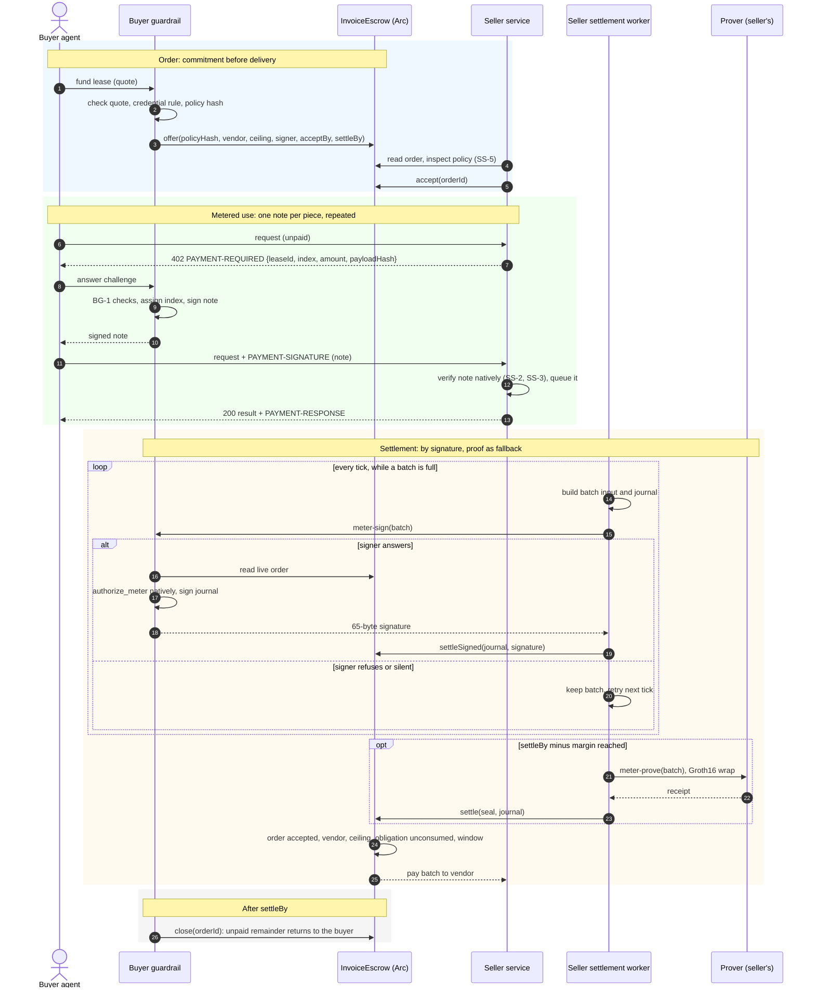
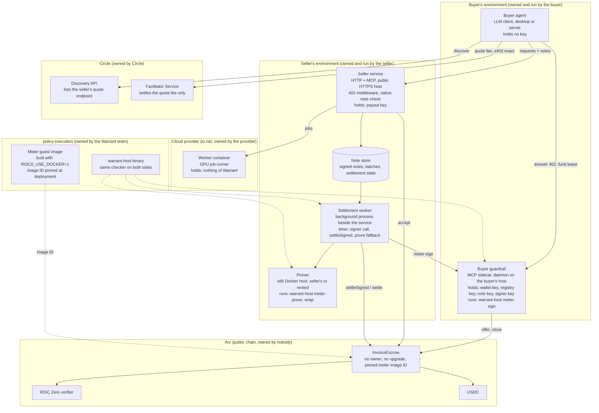

# Specification: the metered payment policy family

Status: **proposed, 2026-10-14. Nothing in this document is implemented.**
Metered payment is a Warrant policy family, beside task, invoice and solver. It is
part of production readiness: track L1 in the [delivery plan](delivery-plan.md) and
an entry in the [policy catalog](policy-catalog.md). The compute marketplace in
[warrant#13](https://github.com/mnemonik-xyz/warrant/pull/13) is its first consumer,
not its owner.

Abbreviations: GPU — Graphics Processing Unit; VPS — Virtual Private Server;
HTTP — Hypertext Transfer Protocol; API — Application Programming Interface.

## 1. Goal

Pay for any service that is sold in pieces, through `InvoiceEscrow`, without a
contract change and without a design per service. The buyer funds one order with a
ceiling. The buyer then pays per piece with a signed note. The seller settles notes in
batches, by signature in the normal case and by proof as the fallback.

The checker does not know what a piece is. A GPU job, an hour of a VPS, a gigabyte,
an API call: the service decides, by the moment it demands a note. The guest, the
escrow and the guardrail are the same for all of them.

Catalog entry: **Metered payment**. Adapters: `meter-proof-v1` on `InvoiceEscrow.settle`
and `meter-signature-v1` on `InvoiceEscrow.settleSigned`, both with the fifteen-word
journal and a deployment pinned to the meter image ID.

## 2. The note

A note is the existing `Acceptance` struct, signed by the key the policy names:

| Field | Content |
|---|---|
| `scope` | chain, escrow, token |
| `task_id` | `hash_tagged("warrant/note/v1", (lease_id, index))` |
| `deliverable_hash` | the payload hash the service put in the challenge; the checker never interprets it |
| `recipient` | the seller, equal to the order's vendor |
| `amount` | the price of this piece, at most the per-note cap in the policy |
| `accepted` | true |
| `valid_after`, `valid_until` | the window inside which the note can settle |

Indices start at zero and are consecutive within a lease. The guardrail assigns them.
The existing `warrant_sign_acceptance` tool signs a note today, with a derived `task_id`.

## 3. The 402 challenge

The service demands a note the way every x402 seller demands a payment. An unpaid
request on a metered path returns `402 Payment Required` with the `PAYMENT-REQUIRED`
header. The header carries a Warrant scheme instead of an EIP-3009 transfer:

```json
{
  "x402Version": 2,
  "resource": { "url": "https://<host>/job", "description": "...", "mimeType": "application/json" },
  "accepts": [
    {
      "scheme": "warrant-note",
      "network": "eip155:5042",
      "asset": "0x3600000000000000000000000000000000000000",
      "payTo": "<seller>",
      "amount": "350000",
      "maxTimeoutSeconds": 60,
      "extra": {
        "escrow": "<InvoiceEscrow>",
        "leaseId": "0x…",
        "index": 17,
        "payloadHash": "0x…",
        "validUntil": 1791900000
      }
    }
  ]
}
```

The client answers with `PAYMENT-SIGNATURE` carrying the signed note. The service
verifies it natively, serves the request, and returns `PAYMENT-RESPONSE` with the note
identifier. The service stores the note for settlement.

The metering rule is therefore not prose. The unit of metering is whichever paths
challenge, and for how much. The OpenAPI document records the 402 response on each
metered path, as the [listing specification](https://github.com/mnemonik-xyz/warrant-showcases/blob/main/docs/circle-listing.md) already does for the
quote path.

Whether Circle's review accepts a resource whose metered paths use this scheme is not
established. The quote path keeps the `exact` scheme, so the listing is not at risk.

## 4. The seller settlement worker

Serving never waits for settlement. A worker inside the seller server settles later:

1. Notes accumulate in a queue as the buyer uses the service.
2. On a timer, the worker takes the unsettled notes that fill a batch, builds the batch input and the journal, and asks the buyer's signing endpoint to countersign. That endpoint runs the new `warrant-host meter-sign`, under the buyer's guardrail. It reads the live order from the chain, runs `authorize_meter` natively on the batch, checks that the journal matches, and signs the journal with the existing `sign_journal`. The note signatures are not settlement signatures. `settleSigned` recovers a 65-byte signature over `signerDigest(journal)`, and `invoice-sign` accepts only invoice requests.
3. The worker calls `settleSigned`.
4. If the signing endpoint refuses or does not answer, the worker keeps the batch and retries on the next tick.
5. At `settleBy` minus a margin, the worker stops retrying and proves every unsettled batch itself: `warrant-host meter-prove`, the Groth16 wrap, then `settle`. One proof covers a whole batch.
6. A partial last batch is settled the same way before `settleBy`.

The worker needs a queue, a timer, the signer call, and the prove-and-settle fallback.
The prover is the seller's own x86 Docker host from the canary plan, or a rented
proving service. The seller runs it because the seller wants to be paid.

Nothing is disputed in this flow. The proof replaces the buyer's countersignature
with a receipt that the same checker ran on the same bytes. The contract pays or
refuses by the same rules either way. No arbiter, no third party, no new trust.

## 4a. Process flow



The diagram shows one lease. Steps 7 to 14 repeat once per piece of service. Steps
15 to 23 run in the background and never block step 14. Step 24 runs at most once per
lease, and only when the signer stayed silent until the margin.

## 4b. Components, deployment and ownership



| Component | Runs where | Owner | Holds | Trusted for |
|---|---|---|---|---|
| Buyer agent | The buyer's desktop or server | Buyer | No key | Nothing. It proposes. |
| Buyer guardrail | A daemon on the buyer's host | Buyer | Wallet key, registry key, note key, signer key | Funding, note signing under BG-1, countersigning batches |
| Seller service | A public HTTPS host of the seller | Seller | Payout key | Serving against notes, SS-1 to SS-8 |
| Note store | The seller's host | Seller | Signed notes, settlement state | Liveness of settlement only |
| Settlement worker | A background process on the seller's host | Seller | Access to the note store and the payout key | Settling in time |
| Prover | The seller's x86 Docker host, or a rented proving service | Seller, or a vendor | Batch inputs | Nothing. The receipt is checked on chain. |
| Worker container | The cloud provider | Provider, rented by the seller | No Warrant key | Nothing. Service quality is outside the protocol. |
| `InvoiceEscrow` | Arc | Nobody. No owner, no upgrade. | Reserved USDC per order | Recipient, ceiling, deadline, one payment per batch |
| RISC Zero verifier | Arc | Nobody | Verifying key | Proof validity |
| Discovery API | Circle | Circle | Listings | Liveness of discovery only |
| Facilitator Service | Circle | Circle | Quote fee settlement | The quote fee only. Never a note or a lease. |
| Meter guest image | Built in `policy-execution`, pinned in the escrow | Warrant team | The checker program | Everything the proof claims |
| `warrant-host` | Buyer's guardrail, seller's worker, seller's prover | Warrant team | The same native checker | Native results equal the guest's |

Three facts follow from the table. No component outside the buyer's environment holds
a key that can spend the buyer's funds. No component outside Arc decides who gets
paid. The seller depends on nobody for settlement except its own worker and, in the
fallback, its own prover.

## 4c. Hardware and other requirements per component

Figures marked "measured" come from `validation-results.md` or the showcase. Figures
marked "unmeasured" are gates, not estimates. ME-8 measures the prover before any
batch size or threshold is chosen.

### Buyer agent

| Requirement | Value |
|---|---|
| Hardware | Any machine that runs the LLM client. No GPU, no key. |
| Software | An MCP client: Claude Desktop, Cursor or a server-side agent. |
| Network | HTTPS to the seller service, to Circle Discovery and, for the quote fee, to the seller's quote endpoint. |
| Keys | None. BG-4. |

### Buyer guardrail

| Requirement | Value |
|---|---|
| Hardware | One always-on host. A small VPS or the buyer's server. Two CPUs and 2 GiB of memory are enough for native checking, which is measured at 0.04 s per decision. |
| Software | Python 3 with `mcp==2.3.0`, `httpx2`, `eth-account`, `pyyaml`. The `warrant-host` binary built with Rust 1.88.0 from `rzup` and `r0vm 3.0.5` for `meter-sign` and `meter-evaluate`. |
| Process | A daemon with a restart policy, not a child of the desktop app. It answers 402 challenges and `meter-sign` calls while the agent is offline. |
| Network | Arc JSON-RPC for order reads and `offer`, `close`. Inbound HTTPS from the seller's worker for `meter-sign`, or an outbound long-poll if the buyer has no inbound address. |
| Keys | Wallet key for `offer` and `close`; registry key; note key; signer key named in the order. Each in a keystore, never in a config file. The note key and the signer key are low-value keys bounded by one order's ceiling. |
| Clock | NTP. Note windows and `settleBy` are compared with block time. |
| State | The next note index per lease, persisted before a note is signed. A lost index means a reused index and a refused request. |

### Seller service

| Requirement | Value |
|---|---|
| Hardware | One public host. Two CPUs and 2 GiB of memory for the service and the worker together. Disk for the note store, below 1 KiB per note. |
| Software | Python 3 with the showcase dependencies, `uvicorn`, Starlette with the MCP transport, the 402 middleware of section 3, and the `warrant-host` binary for native note checks. |
| Network | A public HTTPS host with a valid TLS certificate and a stable DNS name. Circle health-checks it continuously and drops the listing while it is unreachable. Port 443 inbound. Outbound to Arc JSON-RPC, to the cloud provider's API, and to Circle's Facilitator Service for the quote fee. |
| Keys | The payout key, used for `accept`, for the quote signature, for the seller proof toward Circle, and by the worker for `settleSigned` and `settle`. In a keystore. |
| Accounts | A cloud provider account with an API key and prefunded credits, bounded per the canary plan. A Circle API key for the Facilitator Service in production; the Arc testnet trial is keyless. |
| Operations | Rate limiting on the public paths, request logs without note bodies (SS-7), a backup of the note store, alerts for approaching `settleBy`, low gas and a proof backlog, per the delivery plan. |

### Seller settlement worker

| Requirement | Value |
|---|---|
| Hardware | Shares the seller host. |
| Software | The `warrant-host` binary for batch inputs and `meter-evaluate`; Arc JSON-RPC access; a local path or a remote call to the prover. |
| Funds | Native USDC on Arc for gas on `settleSigned` and `settle`. Arc pays gas in USDC. One settlement per batch; the batch size sets the transaction count. |
| Clock | NTP. The margin before `settleBy` is measured in block time. |
| State | Per batch: built, signed, submitted, confirmed, or proving. Persisted so that a restart neither double-submits nor loses a batch. |

### Prover

| Requirement | Value |
|---|---|
| Hardware | x86_64 Linux with Docker. The Groth16 wrap runs only in Docker on x86. CPU count and memory: unmeasured for the meter guest. The measured sample for the invoice guest ran on 14 reported CPUs with four Rayon workers and segment exponent 18, used 2,097,152 cycles in eight segments, and took 445.65 s to prove and 79.73 s to wrap. Peak memory was not recorded. |
| Software | Ubuntu, Docker, Rust via `rustup`, `rzup install rust 1.88.0`, `rzup install r0vm 3.0.5`, Foundry. `scripts/prover-vm.sh` installs all of it on a fresh machine. |
| Settings | `RAYON_NUM_THREADS` and `WARRANT_SEGMENT_PO2` between 16 and 20 to keep proving out of swap. `RISC0_DEV_MODE` is rejected. |
| Alternative | A rented proving service. The receipt is verified on chain, so the prover needs no trust. It needs the batch input, which contains the notes and the credential, not the job payloads. |
| Gate | ME-8: one full batch proved and wrapped on this host, with wall time, CPU seconds and peak memory recorded, before the batch size and the threshold are set. |

### Worker container

| Requirement | Value |
|---|---|
| Hardware | One GPU per container, one replica, duration billing. The showcase uses an RTX 4090 class at about 0.35 USD per hour on io.net. |
| Image | `ghcr.io/mnemonik-xyz/transcription:pilot`, about 1.9 GiB compressed, CUDA 12.3 base, `libcublas-12-3` and `libcudnn9-cuda-12` only, `faster-whisper-small` pinned by revision. Deploy by digest, not by tag. |
| Network | One traffic port, 8080, reachable by the seller service. The buyer reaches it through the seller's metered path, not directly. |
| Keys | None of Warrant. The worker never sees a note. |
| Provider | An io.net account, API key, credits, and the hardware and location identifiers discovered through the provider's API, never invented. |

### Arc

| Requirement | Value |
|---|---|
| Networks | Testnet chain 5042002 at `https://rpc.testnet.arc.io`; mainnet chain 5042 at `https://rpc.mainnet.arc.io`. USDC at `0x3600000000000000000000000000000000000000`, six decimals. Native and ERC-20 USDC share one balance. |
| Contracts | `InvoiceEscrow` and the RISC Zero verifier deployed together by `DeployInvoice.s.sol`, Solidity 0.8.28 Cancun, OpenZeppelin 5.6.1, pinned to the meter image ID from a `RISC0_USE_DOCKER=1` build. The BN254 precompiles at `0x07` and `0x08` answered correctly on testnet. |
| Funds | Deployer gas; buyer ceiling plus gas; seller gas for `accept` and settlements. Canary amounts first. |
| Keys | Deployer in a Foundry keystore or a hardware wallet. Separate low-value buyer, seller and relayer keys. Mainnet keys never in the team's secrets file, per the canary plan. |
| Probe | Before any order: chain ID, precompiles, USDC decimals, and the code hashes of the deployed verifier and escrow against the build. |

### Circle

| Requirement | Value |
|---|---|
| Discovery | Keyless. The listing needs the public HTTPS quote endpoint, the OpenAPI document, the payout wallet and the form. Manual review. |
| Facilitator Service | Keyless trial on Arc testnet. A Circle API key for production. The seller proof signed by the payout key on every call. Used for the quote fee only. |
| Open point | Acceptance of the `warrant-note` scheme on metered paths is not established. |

### Build and release, `policy-execution`

| Requirement | Value |
|---|---|
| Toolchains | Rust 1.98.1 from `rust-toolchain.toml` for the workspace; `rzup` Rust 1.88.0 and `r0vm 3.0.5` for the guests; Solidity 0.8.28 with Foundry; Python 3 for the scripts; Verus for `verified/verify.py`. |
| Reproducible image | `RISC0_USE_DOCKER=1 RISC0_BUILD_LOCKED=1 cargo build -p warrant-host --release --locked` on an x86 Docker host. Record `meter-image-id`. Local builds differ between machines and must not be deployed. |
| Tests | `cargo test -p warrant-policy --locked`, `forge test`, the showcase unit tests, and the Verus run with mutations. The meter checker adds its gate tests and removed-check experiments. |
| Artefacts | The image ID, the deployment addresses and code hashes, the compiler versions and the GHCR digest in one manifest, with local, testnet and mainnet evidence kept apart. |

## 5. The module

The module `core/src/meter.rs` follows the solver path: mandatory gates first, the rule
tree last. It reuses `Acceptance` as the note, `VendorCredential` as the seller
credential, the existing `verify`, and the fifteen-word journal layout of the invoice
path. Nothing changes in Solidity.

```rust
// core/src/meter.rs
pub const CHECKER_VERSION: u32 = 1;
pub const MAX_BATCH: usize = 256;

pub struct MeterPolicy {
    pub version: u64,
    pub customer: Address,        // the funding buyer, bound into the journal
    pub scope: Scope,             // chain, escrow, token
    pub valid_after: u64,
    pub valid_until: u64,
    pub registry_key: Vec<u8>,    // vouches for the seller; the buyer's own key today
    pub acceptance_key: Vec<u8>,  // signs the notes
    pub checker_version: u32,
    pub lease_id: Hash,           // poId on chain
    pub ceiling: u64,             // poMaxTotal on chain
    pub max_note: u64,            // per-note cap
    pub batch_size: u32,          // notes per obligation
    pub rule: Rule,
}

pub struct MeterInput {
    pub policy: MeterPolicy,
    pub request: Request,         // task_id = obligation, amount = batch total
    pub batch: u32,
    pub vendor: VendorCredential,
    pub vendor_signature: Vec<u8>,
    pub notes: Vec<(Acceptance, Vec<u8>)>,   // note and signature, in index order
}

pub struct MeterAuthorization {
    pub authorization: Authorization,
    pub lease_id: Hash,
    pub ceiling: u64,
    pub customer: Address,
}
// journal(): the 12 base words, then lease_id, ceiling, customer,
// byte for byte the InvoiceAuthorization layout.

pub fn note_id(lease_id: &Hash, index: u32) -> Hash
pub fn obligation_id(lease_id: &Hash, batch: u32) -> Hash
pub fn authorize_meter(input: &MeterInput) -> Result<MeterAuthorization, MeterError>
```

`authorize_meter` checks, in this order:

1. Policy: version, scope, both keys, checker version, ceiling, per-note cap and batch size nonzero, batch size at most `MAX_BATCH`, rule valid with the invoice flag off.
2. Request: scope, recipient nonzero, `task_id` equals `obligation_id(lease_id, batch)`.
3. Credential: scope, recipient equals the request recipient, signature under the registry key.
4. Notes: one to `batch_size` notes, indices exactly `batch * batch_size` upward with no gap, each with scope, `task_id` equal to `note_id`, recipient equal to the request, `accepted` true, amount at most the cap, signature under the acceptance key.
5. Amount: the request amount equals the sum of the note amounts, with no overflow.
6. `deliverable_hash`: the request field equals the hash of the ordered note identifiers.
7. Validity window: the intersection of the policy, credential and all note windows.
8. Facts: amount, category, accepted, deliverable, recipient. Then `evaluate`.
9. Evidence hash over the checker version, the credential and the notes.

Batches are disjoint by construction, because a note index belongs to exactly one
batch. Each batch is one obligation, so each note pays once with no contract change.
Batch size one is allowed. The module does not know the spent ceiling or whether an
earlier batch was paid. The contract checks both. It does not know whether the service
ran. Nobody can check that.

The rest of the delta:

| Piece | Work |
|---|---|
| `methods/meter-guest` | Read `MeterInput`, call `authorize_meter`, commit the journal. Add the name to `build.rs`. |
| Host | `meter-image-id`, `meter-evaluate`, `meter-execute`, `meter-prove`, copied from the solver ones. `meter-sign signer-key policy rpc-url batch.json output.json`, modelled on `invoice-sign`: read the order, run the checker natively, sign the journal. |
| Signer path | `signer_digest` and `sign_journal` from `evidence.rs` apply unchanged. |
| Fixtures | One meter journal for the Solidity test that mutates all fifteen words. |
| Template | `templates/meter-v1.json` with ceiling, per-note cap and batch size as parameters. |
| Deployment | `DeployInvoice.s.sol` with the meter image ID. |
| Tests | The positive path, every gate, removed-check mutations. |

## 6. Seller service requirements

- SS-1: A metered path answers an unpaid request with the 402 challenge of section 3, and serves only against a note that verifies natively.
- SS-2: The service refuses a note whose identifier it has seen, and refuses service for it.
- SS-3: The service verifies the note's signature, scope, recipient, lease and amount against the policy it accepted, before it serves.
- SS-4: The settlement worker of section 4 settles every note before the note's `valid_until` and before the order's `settleBy`. The service stops challenging when the time left is below its settlement margin.
- SS-5: Before `accept`, the seller reads the policy: keys, ceiling, per-note cap, batch size, deadlines, and that the rule passes for a sample note. It refuses a policy it cannot settle against.
- SS-6: The OpenAPI document records the 402 response, the scheme and the price on every metered path.
- SS-7: Notes are payment authorizations. The service stores them for settlement and does not log them elsewhere.
- SS-8: The service may challenge before serving or after. Before puts one note of exposure on the buyer. After puts it on the seller. The listing states which.

## 7. Buyer guardrail requirement

- BG-1: The guardrail answers a 402 challenge only when the lease is one it funded, the recipient equals the order's vendor, the escrow and network match the order, the amount is at most the per-note cap, and a per-lease rate limit allows it. Everything else is refused.
- BG-2: The guardrail assigns consecutive indices per lease and never signs two notes with the same index.
- BG-3: The guardrail runs the signing endpoint of section 4 for its own leases, with `meter-sign` and the signer key named in the order.
- BG-4: The agent never holds the note key. It asks the guardrail, which enforces BG-1.

## 8. Trust assumptions

| Assumption | If it fails |
|---|---|
| The note key is held by the buyer, through the guardrail | An attacker spends the ceiling on service to the fixed recipient. Loss is bounded by the ceiling and the deadline. The key cannot be rotated inside an order. Keep orders small. |
| The seller's recipient is the address the buyer meant | A wrong credential pays the wrong seller for service received. The credential rule of the marketplace proposal decides who may be a seller. |
| The meter image ID pinned in the escrow is the reviewed guest | Everything else holds for a wrong program. Reproducible build and the code-hash probe of the canary plan. |
| RISC Zero soundness, the verifier, the BN254 precompiles on Arc | Existing assumptions, unchanged. |
| Block time for windows and `settleBy` | Existing assumption. The worker keeps a margin. |
| Nothing about Circle, the cloud provider, the marketplace or the prover | They affect liveness and cost, not who gets paid. |

## 9. Attack surface

| Attacker | Attempt | Outcome |
|---|---|---|
| Buyer | Withhold a note | No service for that piece. Nothing else. |
| Buyer | Reuse an index | SS-2 refuses the request. |
| Buyer | Sign a note with a wrong amount, recipient or lease | SS-3 refuses before serving. |
| Buyer | Sign a note with a window too short to settle | SS-3 refuses before serving. |
| Buyer | Stop near `settleBy` so the seller cannot settle | SS-4: the service stops first, by its margin. |
| Buyer | Refuse to countersign a batch | The worker proves the batch. Delay only. |
| Buyer | Revoke the signer | `revokeSigner` only tightens. The worker proves. |
| Buyer | Cancel after `accept` | Impossible before `settleBy`. |
| Buyer | Never answer the first challenge | The seller loses provisioning cost. The no-show residue. |
| Seller | Forge a note | Impossible. |
| Seller | Settle a batch twice, or count a note in two batches | One obligation per batch, indices in exactly one batch, consumed on chain. |
| Seller | Settle notes of another lease, chain or customer | Lease, scope and customer are in the signed note and the journal. |
| Seller | Overcharge | The amount is the sum of notes the buyer signed, each at most the cap. |
| Seller | Take a note and not serve | The buyer loses one piece and stops. SS-8 states who carries that piece. |
| Seller | Settle before any service | No note exists before the buyer asks. |
| Anyone | Replay a settlement, relay to another recipient | Consumed obligation, recipient fixed, any relayer pays only the recipient. |
| Listing board | Serve a false `payTo` | The quote signature must recover to the listed address. The credential rule decides. |

What this does not secure: quality of service, the hardware model, response time. The
buyer's remedy is to stop. That is the same limit every metered cloud has.

## 10. Acceptance criteria

- ME-1: `authorize_meter` rejects every gate of section 5 in a dedicated test, and a removed-check experiment fails for each.
- ME-2: The meter journal is byte for byte the `InvoiceAuthorization` layout, and the Solidity fixture test that mutates all fifteen words passes with a meter journal.
- ME-3: `settleSigned` with a `meter-sign` signature and `settle` with a receipt both pay one batch on `InvoiceEscrow` on local Anvil, and a second settlement of the same batch, or a batch that reuses an index, is rejected.
- ME-4: A note with `valid_after` in the future is rejected by the contract until that time.
- ME-5: `meter-image-id` is recorded from a `RISC0_USE_DOCKER=1` build before any deployment.
- ME-6: A metered path returns the 402 challenge of section 3 unpaid, serves against a valid note, and refuses a reused index.
- ME-7: The settlement worker settles a batch by signature, retries on refusal, and settles by proof before `settleBy` when the signer stays silent, in a test with a mocked signer and a mocked verifier.
- ME-8: Proving time and cost for one full batch are measured on the x86 prover before any threshold or batch size is chosen.

## 11. Effort

About one engineer-week for the family: the module and its tests, the guest, five
host subcommands including the signer, one fixture, one template, one deployment script run. About three
days for the seller side: the 402 middleware on the showcase service and the settlement
worker. About two days for the guardrail: the challenge handler and the signing
endpoint. The Verus proof covers the evaluator only. The meter checker is tested, not
proved, like the other two checkers.
