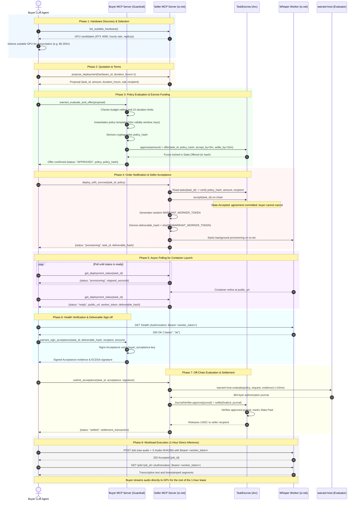

# io.net GPU Workload Pilot with Warrant on Arc

This showcase demonstrates autonomous cloud compute procurement, container deployment, and
on-chain escrow settlement on Arc testnet (chain ID `5042002`) using the Warrant policy framework.
The section [Arc mainnet seller (canary)](#arc-mainnet-seller-canary) describes the hosted
seller for Arc mainnet (chain ID `5042`).

An autonomous buyer LLM agent interacts with an io.net GPU compute seller MCP server. A local
Buyer Warrant MCP guardrail verifies policy rules (budget cap, lease duration, deterministic
policy hash) before funding `TaskEscrow` on Arc. Once escrow is funded, the seller provisions a
`faster-whisper` transcription worker container on io.net, settles escrow upon buyer acceptance
verification, and transcribes audio submitted by the buyer.

> [!IMPORTANT]
> For the manual CLI deployment runbook without MCP, see [README.dev.md](README.dev.md).

---

## Showcase Limitations

This showcase is an infrastructure and agent-interaction pilot. It demonstrates cryptographic
policy evaluation, capability deliverable verification, and dual-MCP orchestration with the
following design trade-offs:

1. **Mock On-Chain ZK Verification (`JournalVerifier`)**:
   - On-chain `TaskEscrow` settlement on Arc uses pre-approved digest verification
     (`JournalVerifier`) with a mock seal (`0xabcd`), rather than full RISC Zero Groth16
     proving (which requires Docker and takes 2–4 minutes per proof).
   - Off-chain policy evaluation is **fully real and cryptographic**: the native Rust
     `warrant-host evaluate` binary executes in under 10ms, cryptographically verifying all
     ECDSA authority signatures (`registry.key`, `buyer_acceptance.key`), category limits,
     and budget constraints to produce the canonical 384-byte authorization journal.
2. **No Hardware TEE Attestation**:
   - The compute seller provides **no hardware attestation** (such as AMD SEV-SNP or Intel TDX)
     proving that the container was isolated in a Confidential VM or that io.net allocated
     the claimed GPU model.
   - Capability verification relies on the secret `WARRANT_WORKER_TOKEN` and its matching
     `deliverable_hash = sha256(WARRANT_WORKER_TOKEN)`. Once the buyer agent verifies container
     `/health` with the bearer token, it signs an `Acceptance` statement authorizing settlement.
3. **Escrow Safety with Capability Tokens**:
   - Unlike naive pilots that settle escrow immediately upon deployment, this showcase enforces
     a two-step workflow: the seller accepts the task on-chain to commit terms, provisions the
     container in the background, and can only claim escrow payment after the buyer verifies
     `/health` and signs an `Acceptance` evidence struct off-chain.
   - On Arc mainnet, this protection does not hold: after seller acceptance, anyone can
     trigger payout. See [Arc mainnet seller (canary)](#arc-mainnet-seller-canary).
4. **Trust Boundary**:
   - The local Buyer Guardrail strictly prevents unauthorized transactions or spending cap
     violations before funds ever leave the buyer's wallet.
   - For post-settlement transcription, the buyer directly submits inference jobs to the
     authenticated worker during its 1-hour lease window.

---

## The Dual-MCP Architecture: Seller Service & Buyer Guardrail

In an autonomous agent economy, buyers interact with untrusted seller agents. An autonomous
buyer LLM agent cannot be entrusted with unrestricted private keys or unconstrained spending:
hallucinations or prompt injections could drain funds or accept malicious contracts.

To solve this, the architecture separates the remote seller's service from the buyer's local
guardrail sidecar:

```
  ┌─────────────────────────────────────────────────────────────────────────────┐
  │                         Buyer LLM Agent Environment                         │
  │                                                                             │
  │     1. list_suitable_hardware()           3. warrant_evaluate_and_offer()   │
  │     2. propose_deployment()                      (Local Policy Check &      │
  │     4. deploy_with_escrow()                       On-Chain Escrow Funding)  │
  │     5. submit_acceptance()                               │                  │
  └───────────────┬──────────────────────────────────────────┼──────────────────┘
                  │                                          │
                  ▼                                          ▼
   ┌──────────────────────────────┐          ┌──────────────────────────────┐
   │      Seller MCP Server       │          │   Buyer Warrant MCP Server   │
   │  (Remote Streamable HTTP)    │          │    (Local Guardrail Sidecar) │
   │                              │          │                              │
   │ • Discovers io.net GPUs      │          │ • Enforces max budget ($2)   │
   │ • Builds pricing proposals   │          │ • Enforces max duration (1h) │
   │ • Accepts on-chain escrow    │          │ • Verifies policy hash       │
   │ • Provisions Whisper worker  │          │ • Approves & calls offer()   │
   │ • Settles 384-byte journal   │          │ • Tracks escrow state        │
   └──────────────┬───────────────┘          └──────────────┬───────────────┘
                  │                                         │
                  │              Arc Blockchain             │
                  └────────► [ TaskEscrow Contract ] ◄──────┘
```

1. **Seller MCP Server (`seller_mcp_server.py`)**:
   - Hosted remotely by the compute provider over Streamable HTTP (default port 8000).
   - Generates proposals with dynamic hardware pricing, provisions 1-hour Whisper GPU containers,
     and settles deliverables on `TaskEscrow` with a 384-byte authorization journal.
2. **Buyer Warrant MCP Server (`buyer_mcp_server.py`)**:
   - Runs locally alongside the buyer agent as a trusted guardrail sidecar.
   - Holds the buyer's private keys, spending caps, and category whitelist.
   - Independently computes and verifies the cryptographic `warrant-policy` hash before signing
     any transaction.
   - Approves token allowance and submits `TaskEscrow.offer()` on-chain.
   - Supports `stdio` (for Claude Desktop / Cursor / Antigravity) and Streamable HTTP (port 8001).
3. **Arc `TaskEscrow` Contract**: Holds buyer USDC in escrow until valid terms and deliverable
   settlement are executed.
4. **[Transcription Worker](https://github.com/mnemonik-xyz/transcription)**: CUDA/FP16 `faster-whisper` container exposing HTTP
   endpoints (`/health`, `/job`, `/jobs`) with structured operational logs and GPU telemetry.

---

## End-to-End Autonomous Lifecycle

The sequence below illustrates the complete lifecycle between the **Buyer LLM Agent**, the local
**Buyer MCP Guardrail**, the remote **Seller MCP Server**, and the on-chain **`TaskEscrow`**
contract on Arc.

The capability deliverable is the authenticated GPU worker session: the seller generates a secret
`WARRANT_WORKER_TOKEN`, derives `deliverable_hash = sha256(WARRANT_WORKER_TOKEN)`, and provides it
alongside `public_url`. Once the buyer agent verifies container `/health`, the buyer signs an
`Acceptance` statement off-chain, enabling the seller to settle on Arc:



---

## Exposed MCP Tools

The dual-MCP architecture separates the remote Seller compute tools from the local Buyer
guardrail sidecar tools:

* **Buyer Guardrail (`buyer-warrant-guardrail`)**: Enforces local budget caps, duration limits,
  and category whitelists, independently compiles policy hashes, submits `TaskEscrow.offer()`,
  and signs deliverable acceptance receipts (`buyer_acceptance.key`).
* **Seller Service (`seller-mcp-server`)**: Discovers io.net GPU hardware, calculates duration
  quotes, provisions containers, evaluates authorization off-chain via native Warrant, and
  settles payment on Arc.

Detailed tool specifications, argument schemas, verified return structures, and agent prompt
guidelines are maintained in the agent skill definition:

**[skills/ionet/SKILL.md](skills/ionet/SKILL.md)**

---

## Desktop Agent Configuration (Claude Desktop, Cursor, Antigravity)

Configure both MCP servers in your agent settings (e.g. `claude_desktop_config.json`).
Because the Buyer Guardrail manages local keys and spending limits, it runs locally via
`stdio`. The Seller Service is hosted remotely by the compute provider over Streamable HTTP:

```json
{
  "mcpServers": {
    "buyer-warrant-guardrail": {
      "command": "/path/to/repo/.venv/bin/python",
      "args": [
        "-m", "showcases.ionet_arc.buyer_mcp_server",
        "--transport", "stdio"
      ]
    },
    "seller-transcription-service": {
      "url": "http://<seller-host>:8000/mcp"
    }
  }
}
```

> [!NOTE]
> If your client does not support direct HTTP MCP URLs, bridge the remote endpoint via
> `mcp-remote`: `"command": "npx", "args": ["-y", "mcp-remote", "http://<seller-host>:8000/mcp"]`.
> For the Arc mainnet seller with basic auth, see
> [Desktop configuration for mainnet](#desktop-configuration-for-mainnet).

The agent prompts can then naturally discover GPU hardware, request a quote, submit it to
the local Warrant tool for policy check and escrow funding, deploy, and transcribe audio.

---

## Arc mainnet seller (canary)

Status 2026-10-15, unverified: the endpoint does not answer yet, and the deployment PR fills
in the addresses below.

The seller MCP for Arc mainnet (chain ID `5042`) runs at `https://seller.mnemonik.xyz/mcp`.
It settles through the no-proof escrow `TaskEscrow` and the test-double `JournalVerifier`.
Access needs basic auth. The operator hands out the credential personally. This README never
holds the credential.

The seller puts this label in its `initialize` instructions and at the start of the
descriptions of `propose_deployment`, `deploy_with_escrow` and `submit_acceptance`:

> after seller acceptance anyone can trigger payout; no proof; amounts up to 1 USD

The `initialize` instructions also state these limits:

> Settlement uses a test-double verifier that accepts any digest the seller approves. The 1 USD cap and the one-hour lease are seller policy, not contract rules. One deal at a time. The mainnet seller path has not been exercised with money before this listing. Any holder of the basic-auth credential can read the current deployment status, including its worker token.

The seller path on mainnet (funding, acceptance, GPU provisioning, settlement) has not run
with money. The first buyer is therefore the first test.

Further limits for the buyer:

- The compiled buyer policy is valid for 900 seconds (`validity_seconds: 900`). Sign the
  acceptance within 15 minutes of the policy compilation.
- The buyer guardrail refuses a proposal above `max_budget_usd` of the manifest (1.00).
  The policy rule comes from [`config/buyer_policy_template.yaml`](config/buyer_policy_template.yaml)
  and allows up to 2.00 USDC. Do not edit the template: the 1.00 limit comes from the manifest.
- On chain 5042, `deploy_with_escrow`, `get_deployment_status` and `submit_acceptance` need
  the `task_id`. It is the `TaskEscrow` task ID that `propose_deployment` returns: `0x`
  and 64 hex digits.
- Any basic-auth holder who knows a public `task_id` can read the worker token through
  `get_deployment_status`.
- While the seller accepts one deal (up to about 30 seconds), it refuses a second
  `deploy_with_escrow` with "another deal is being accepted". Try again after the active
  deal ends. The buyer can still refund an offer that the seller did not accept.

### Mainnet addresses

| Role / Contract | Address or key |
| --- | --- |
| **TaskEscrow** (no-proof escrow) | `<TASK_ESCROW_ADDRESS>` |
| **JournalVerifier** (test double) | `<JOURNAL_VERIFIER_ADDRESS>` |
| **USDC Token** | `0x3600000000000000000000000000000000000000` |
| **Seller** (payout wallet) | `<SELLER_ADDRESS>` |
| **Registry public key** | `<REGISTRY_PUBLIC_KEY>` |

The deployment PR also publishes `config/mainnet-public_keys.yaml` (repository path
`showcases/ionet_arc/config/mainnet-public_keys.yaml`). It holds the registry public key only.

### Buyer setup

Run every command from the repository root.

1. Build the binaries with `cargo build --release -p warrant-host`. The buyer guardrail
   finds `warrant-policy` and `warrant-evidence` in `target/release/` or `target/debug/`.
   Without the build, it fails with "Could not find compiled binary".
2. Copy [`config/mainnet-manifest.example.yaml`](config/mainnet-manifest.example.yaml) to
   your own file outside git. Set the fields of the manifest table after step 7.
3. Give the guardrail your own funded Arc wallet key. Use one of these inputs:
   - the flag `--key-file <path>`;
   - the manifest field `private_key_files.buyer_key`;
   - the environment variable `WARRANT_BUYER_KEY`.

   Use `--key-file` or `private_key_files.buyer_key` with a file of mode 0600. Give an
   absolute path: a relative path resolves against the repository root. Never put
   the key in the desktop configuration. Do not use `--private-key`, because the process
   list shows its value.
4. Generate your own acceptance key. Never use a key that another person gave you.

   ```bash
   mkdir -p showcases/ionet_arc/.keys
   (umask 077 && openssl rand -hex 32 > showcases/ionet_arc/.keys/buyer_acceptance.key)
   ```

   The file holds 64 hex characters without `0x`, the same form that `init.py` writes.
   The path `showcases/ionet_arc/.keys/buyer_acceptance.key` is fixed in
   `buyer_mcp_server.py` and `escrow.py`. No flag or manifest field changes it.
5. Get the public part of the acceptance key as `0x` hex. `warrant-evidence public-key`
   prints a JSON array of 33 byte values, so convert it:

   ```bash
   target/release/warrant-evidence public-key showcases/ionet_arc/.keys/buyer_acceptance.key \
     | python3 -c 'import json,sys; print("0x"+bytes(json.load(sys.stdin)).hex())'
   ```

6. Copy the published `config/mainnet-public_keys.yaml` to your own file. Add the line
   `buyer_acceptance_key: '0x<hex from step 5>'`. Set `public_files.public_keys` of your
   manifest to the absolute path of this file. A relative path resolves against the
   repository root first. The published file has no `buyer_acceptance_key`. Each buyer
   signs the acceptance with an own key. A shared key lets other people accept in your name.
7. Configure the desktop agent as shown in the next section.

| Manifest field | Buyer value |
| --- | --- |
| `chain_id` | `5042` |
| `rpc_url` | `https://rpc.mainnet.arc.io`, or your own Arc mainnet RPC |
| `escrow_address` | `<TASK_ESCROW_ADDRESS>` |
| `verifier_address` | `<JOURNAL_VERIFIER_ADDRESS>` |
| `token_address` | `0x3600000000000000000000000000000000000000` |
| `category` | `42` |
| `max_budget_usd` | `1.00` |
| `duration_hours` | `1` |
| `validity_seconds` | `900` |
| `buyer_address` | Your own funded Arc wallet. Add this field: the example file does not have it. |
| `public_files.public_keys` | Absolute path of your own public keys file (step 6) |
| `private_key_files.buyer_key` | Optional. Absolute path of your wallet key file (step 3) |

The guardrail does not read the other entries of the example file. `seller_address`,
`vendor_validity_days`, `public_files.vendor_credential` and `public_files.vendor_signature`
are seller-side values. `private_key_files.registry_key`, `private_key_files.buyer_acceptance_key`
and `private_key_files.seller_key` are seller-side key paths that `init.py` and the seller
read on the VM. Ignore them or delete them.

### Desktop configuration for mainnet

```json
{
  "mcpServers": {
    "buyer-warrant-guardrail": {
      "command": "/path/to/repo/.venv/bin/python",
      "args": [
        "-m", "showcases.ionet_arc.buyer_mcp_server",
        "--transport", "stdio",
        "--manifest", "/path/to/your/mainnet-manifest.yaml",
        "--key-file", "/path/to/your/buyer.key"
      ]
    },
    "seller-transcription-service": {
      "command": "npx",
      "args": ["-y", "mcp-remote", "https://seller.mnemonik.xyz/mcp", "--header", "Authorization:${AUTH_HEADER}"],
      "env": {
        "AUTH_HEADER": "Basic <base64 of user:password>"
      }
    }
  }
}
```

`mcp-remote` puts the value of the environment variable `AUTH_HEADER` in place of
`${AUTH_HEADER}`. The header argument has no space after the colon, because some clients
split arguments on spaces. Set `AUTH_HEADER` to `Basic` and the base64 form of
`user:password` from the operator. The configuration file then holds the credential:
keep it at mode 0600 and out of git. If your client passes the shell environment to
`mcp-remote`, export `AUTH_HEADER` in that shell and remove the `env` block. Unverified on 2026-10-15: this form follows the
`mcp-remote` documentation, and it has not run against this endpoint.

### Operator notes

- The seller refuses to start when the RPC does not answer `eth_chainId`. It exits with
  "cannot determine the chain". Check the RPC before you start the seller.
- A blocked deal slot stops new deals. A session in `provisioning` after a crash or a
  restart blocks the slot. So does an unreadable file in `<IONET_STATE_DIR>/sessions/`,
  or a `failed` session with `"deployment_may_exist": true` before its `expires_at`.
  The refusal names the task or the file. To clear the slot:
  1. In the io.net console, make sure that no deployment for that task runs or bills.
     Destroy a deployment that does.
  2. In `<IONET_STATE_DIR>/sessions/<task_id>.json`, set `"status": "failed"` and remove
     `deployment_may_exist`, or set `expires_at` to a past Unix time. Edit the file as the
     container user, and keep the JSON valid.
  3. Move an unreadable file out of `sessions/`.

  No restart is necessary. By design, a failed deal whose io.net deploy state file exists
  blocks the next deal for up to one hour.

---

## Arc and Showcase Parameters

### 1. Network Parameters

Official network parameters for Arc:

| Parameter | Arc mainnet | Arc testnet |
| --- | --- | --- |
| Chain ID | 5042 | 5042002 |
| RPC URL | `https://rpc.mainnet.arc.io` | `https://rpc.testnet.arc.io` |
| USDC ERC-20 | `0x3600000000000000000000000000000000000000` | Same address |
| ERC-20 decimals | 6 | 6 |
| Native gas decimals | 18 | 18 |

Native and ERC-20 USDC share a unified balance on Arc. Warrant token amounts use six-decimal
integer units ($1.00 \text{ USDC} = 1\,000\,000$ atomic units), reserving native USDC for gas fees.

### 2. Showcase Contract & Wallet Addresses

The showcase contracts and demo participant addresses are defined in
[`config/manifest.yaml`](config/manifest.yaml):

| Role / Contract | Address | Description |
| --- | --- | --- |
| **TaskEscrow** | `0xBeD9B731D9C912541FF083AE41607016BFe93b70` | Escrow contract on Arc |
| **JournalVerifier** | `0xDbefc776e18e34049cAaec736b47122f0583F345` | Digest verifier on Arc |
| **USDC Token** | `0x3600000000000000000000000000000000000000` | Arc USDC token |
| **Seller** | `0x9F188809b2ba2e29653693C4069c212a95C1B8c4` | io.net payout wallet |
| **Buyer** | `0x9793Dd93D46F153a2A879165cd163A01b54d8A00` | Escrow funder wallet |

- **Buyer Address (`buyer_address` / `buyer_account`)**: The buyer agent's funded wallet. It
  approves USDC allowance and calls `TaskEscrow.offer()` to fund deposits. This address is
  cryptographically bound into each unique task identifier (`taskId = hash(customer, salt)`).
- **Seller Address (`seller_address` / `server_account`)**: The compute seller's payout wallet
  (io.net service provider). Certified by Registry Authority credentials to receive settlements
  for GPU Whisper transcription (category 42), and receives USDC upon escrow settlement.

---

## Deploying Contracts to Arc Testnet

### 1. Build Host and Obtain Guest Image ID

Build the Rust `warrant-host` binary to inspect the policy guest image ID:

```sh
RISC0_BUILD_LOCKED=1 cargo build -p warrant-host --release --locked
IMAGE_ID=$(target/release/warrant-host image-id)
echo "Warrant Guest Image ID: $IMAGE_ID"
```

### 2. Deploy Contracts

Deploy `TaskEscrow` and `RiscZeroGroth16Verifier` from the `contracts/` directory using Foundry:

```sh
cd contracts

export WARRANT_RPC_URL=https://rpc.testnet.arc.io
export WARRANT_TOKEN=0x3600000000000000000000000000000000000000
export WARRANT_IMAGE_ID="$IMAGE_ID"
export WARRANT_DEPLOYER="<your-deployer-address>"

# Option A: Full RISC Zero Groth16 Verifier (requires Docker proving):
forge script script/Deploy.s.sol:Deploy --rpc-url "$WARRANT_RPC_URL" \
  --account warrant-deployer --sender "$WARRANT_DEPLOYER" --broadcast --slow

# Option B: Fast JournalVerifier (pre-approved digest for showcase / testnets):
forge script script/DeployMock.s.sol:DeployMock --rpc-url "$WARRANT_RPC_URL" \
  --account warrant-deployer --sender "$WARRANT_DEPLOYER" --broadcast --slow
```

### 3. Verify Contracts

Verify the deployed contracts on Arc Testnet via Blockscout using the saved broadcast artifacts:

```sh
forge script script/Deploy.s.sol:Deploy \
  --rpc-url "$WARRANT_RPC_URL" \
  --broadcast \
  --resume \
  --verify \
  --verifier blockscout \
  --verifier-url https://explorer.testnet.arc.io/api
```

---

## Running the Showcase

Both `seller_mcp_server.py` and `buyer_mcp_server.py` automatically read their initial parameters
(`rpc_url`, `escrow_address`, `verifier_address`, `token_address`, `seller_address`, and
`buyer_address`) directly from [`config/manifest.yaml`](config/manifest.yaml) by default (or via
`--manifest <path>`). You can still override `--rpc-url` via CLI arguments.

### 1. Run the Seller MCP Server

Start the Seller MCP daemon:

```sh
# Live io.net Cloud mode:
.venv/bin/python -m showcases.ionet_arc.seller_mcp_server \
  --host 0.0.0.0 --port 8000

# Local / remote SSH server mode (deploys container via SSH and Docker):
.venv/bin/python -m showcases.ionet_arc.seller_mcp_server \
  --host 0.0.0.0 --port 8000 \
  --local-server --ssh-host petertower
```

Execution modes:
- **Live io.net Cloud (default)**: Uses io.net CaaS API credentials (`IONET_API_KEY`) to deploy
  GPU instances dynamically.
- **Local / Remote Server (`--local-server`)**: Deploys the Whisper container via SSH to a GPU
  server (`docker run --gpus all -p 8080:8080`). Accepts `--ssh-host <host>` (default: `localhost`)
  and `--worker-url <url>` (default: `http://<ssh-host>:8080`).

On live networks like Arc Testnet, the seller agent signs `TaskEscrow.accept()` and
`TaskEscrow.settle()` on-chain. Configure the seller private key via any of:
- File: save to `showcases/ionet_arc/.keys/seller.key` (or reference in `manifest.yaml`
  under `private_key_files.seller_key`)
- Environment variable: `export WARRANT_SELLER_KEY="0x..."` (or `WARRANT_PRIVATE_KEY`)
- CLI flag: `--private-key 0x...` or `--key-file <path>`

Optional CLI flags: `--manifest <path>`, `--rpc-url <url>`, `--server-account <address>`,
`--private-key <hex>`, `--key-file <path>`.

### 2. Run the Buyer Warrant MCP Server

Start the Buyer Warrant guardrail sidecar:

```sh
# Run over stdio (standard for desktop LLM agents):
.venv/bin/python -m showcases.ionet_arc.buyer_mcp_server \
  --transport stdio

# Run over Streamable HTTP (default localhost:8001):
.venv/bin/python -m showcases.ionet_arc.buyer_mcp_server \
  --transport streamable-http
```

On live networks such as Arc Testnet, the buyer agent signs on-chain transactions (`USDC.approve`
and `TaskEscrow.offer`) locally. Configure the buyer private key via any of:
- File: save the key to `showcases/ionet_arc/.keys/buyer.key` (or reference in `manifest.yaml`
  under `private_key_files.buyer_key`)
- Environment variable: `export WARRANT_BUYER_KEY="0x..."` (or `WARRANT_PRIVATE_KEY`)
- CLI flag: `--private-key 0x...` or `--key-file <path>`

Optional CLI flags: `--manifest <path>`, `--rpc-url <url>`, `--auto-mint`, `--private-key <hex>`,
`--key-file <path>`.

### 3. Run with an LLM Agent or Headless Test Runner

#### A. Interactive LLM Agent (Claude Desktop, Cursor, Antigravity)

In real-world use, you interact with a real LLM agent configured with the two MCP servers
(the remote Seller service and the local Buyer guardrail sidecar).

Prompt the agent with a natural request:
> *"Discover available single-GPU options on io.net, select the cheapest suitable GPU within my $2*
> *budget, fund escrow on Arc, deploy the Whisper container, and transcribe `./sample.mp3`."*

The LLM autonomously drives the end-to-end lifecycle:
1. Discovers suitable single-GPU hardware on io.net (`seller:list_suitable_hardware`).
2. Requests an agreement proposal with dynamic pricing (`seller:propose_deployment`).
3. Evaluates proposal terms and funds escrow on Arc (`buyer:warrant_evaluate_and_offer`).
4. Commits agreement on-chain and starts container provisioning (`seller:deploy_with_escrow`).
5. Polls until container is online (`seller:get_deployment_status`).
6. Verifies container `/health` and signs deliverable receipt (`buyer:warrant_sign_acceptance`).
7. Submits acceptance to settle escrow on-chain (`seller:submit_acceptance`).
8. Submits audio directly to the Whisper container via `curl` (`POST /job` and `GET /job/<job_id>`).

#### B. Headless Automated Test Runner

For automated integration testing, CI/CD, or headless demonstrations without an LLM GUI,
run the scripted test agent:

```sh
.venv/bin/python -m showcases.ionet_arc.buyer_test_agent \
  --mcp-url http://127.0.0.1:8000/mcp \
  --buyer-mcp-url http://127.0.0.1:8001/mcp \
  --rpc-url https://rpc.testnet.arc.io \
  --audio ./sample.mp3
```

---

## Worker HTTP API and Operational Logs

The [transcription worker](https://github.com/mnemonik-xyz/transcription) HTTP service exposes the following endpoints:

| Request | Authentication | Result |
| --- | --- | --- |
| `GET /health` | None | Process health status |
| `POST /job` | `Bearer WORKER_TOKEN` | Upload raw audio, receive job status and `job_id` |
| `GET /job/<job_id>` | Same token | Status, transcript text, segments, and timing for one job |
| `GET /jobs` | Same token | Status of all submitted jobs |

Uploads require `Content-Length` and `X-Audio-SHA256`. An optional language code may be passed
via `?language=<code>` or `X-Language: <code>`. Maximum upload size is 64 MiB. The `job_id` is
the lowercase SHA-256 hash of the input audio bytes.

The worker writes human-readable operational logs with job ID prefixes, elapsed execution time,
and best-effort `nvidia-smi` GPU telemetry (utilization, memory used/total, temperature, power).
Set `WARRANT_LOG_JSON=1` for raw JSON logs.

---

## Installation and Automated Tests

Python 3.12+ is supported. Install dependencies from the repository root:

```sh
python3 -m venv .venv
.venv/bin/pip install -r showcases/ionet_arc/requirements.txt
```

Run test suite:

```sh
# Run entire test suite
.venv/bin/python -m unittest discover showcases/ionet_arc -v

# Or run individual suites:
# Buyer Warrant guardrail MCP server unit tests
.venv/bin/python -m unittest showcases.ionet_arc.test_buyer_mcp_server -v

# Seller transcription MCP server unit tests
.venv/bin/python -m unittest showcases.ionet_arc.test_warrant_transcription -v

# TaskEscrow Web3 client unit tests
.venv/bin/python -m unittest showcases.ionet_arc.test_escrow -v

# Core io.net CaaS pilot unit tests
.venv/bin/python -m unittest showcases.ionet_arc.test_pilot -v

# End-to-end integration test (spins up Anvil, Seller MCP, Buyer MCP, Agent)
.venv/bin/python -m unittest showcases.ionet_arc.test_demo_e2e -v
```

Python sources are linted and formatted with [Ruff](https://docs.astral.sh/ruff/):

```sh
.venv/bin/pip install -r showcases/ionet_arc/requirements-dev.txt
.venv/bin/ruff check showcases/ionet_arc
.venv/bin/ruff format --check showcases/ionet_arc
```

---

## Manual CLI Deployment Runbook

For running manual container discovery, price estimation, deployment, and teardown via the
standalone CLI (`scripts/ionet-showcase.py`) without MCP agents, refer to the
[Developer Runbook](README.dev.md).

---

## Primary References

- [io.net Agent Cloud documentation](https://io.net/docs/guides/clouds/agent-cloud)
- [CaaS container deployment reference](https://io.net/docs/reference/caas/deploy-a-container)
- [CaaS price estimation reference](https://io.net/docs/reference/caas/price-estimation)
- [Arc connection details and RPC](https://docs.arc.io/arc/references/connect-to-arc)
- [Arc EVM differences](https://docs.arc.io/integrate/evm-differences)
- [Circle USDC addresses](https://developers.circle.com/stablecoins/usdc-contract-addresses)
- [faster-whisper repository](https://github.com/SYSTRAN/faster-whisper)
