# io.net GPU Workload Pilot with Warrant on Arc

This showcase demonstrates autonomous cloud compute procurement, container deployment, and
on-chain escrow settlement on Arc (chain ID `5042002`) using the Warrant policy framework.

An autonomous buyer LLM agent interacts with an io.net GPU compute seller MCP server. A local
Buyer Warrant MCP guardrail verifies policy rules (budget cap, lease duration, deterministic
policy hash) before funding `TaskEscrow` on Arc. Once escrow is funded, the seller provisions a
`faster-whisper` transcription worker container on io.net, settles escrow upon buyer acceptance
verification, and transcribes audio submitted by the buyer.

> [!IMPORTANT]
> For the manual CLI deployment runbook without MCP, see [README.dev.md](README.dev.md).

---

## Showcase Limitations

This showcase is an infrastructure and agent-interaction pilot. It demonstrates cryptographic
policy evaluation, capability deliverable verification, and dual-MCP orchestration with the
following design trade-offs:

1. **Mock On-Chain ZK Verification (`JournalVerifier`)**:
   - On-chain `TaskEscrow` settlement on Arc uses pre-approved digest verification
     (`JournalVerifier`) with a mock seal (`0xabcd`), rather than full RISC Zero Groth16
     proving (which requires Docker and takes 2–4 minutes per proof).
   - Off-chain policy evaluation is **fully real and cryptographic**: the native Rust
     `warrant-host evaluate` binary executes in under 10ms, cryptographically verifying all
     ECDSA authority signatures (`registry.key`, `buyer_acceptance.key`), category limits,
     and budget constraints to produce the canonical 384-byte authorization journal.
2. **No Hardware TEE Attestation**:
   - The compute seller provides **no hardware attestation** (such as AMD SEV-SNP or Intel TDX)
     proving that the container was isolated in a Confidential VM or that io.net allocated
     the claimed GPU model.
   - Capability verification relies on the secret `WARRANT_WORKER_TOKEN` and its matching
     `deliverable_hash = sha256(WARRANT_WORKER_TOKEN)`. Once the buyer agent verifies container
     `/health` with the bearer token, it signs an `Acceptance` statement authorizing settlement.
3. **Escrow Safety with Capability Tokens**:
   - Unlike naive pilots that settle escrow immediately upon deployment, this showcase enforces
     a two-step workflow: the seller accepts the task on-chain to commit terms, provisions the
     container in the background, and can only claim escrow payment after the buyer verifies
     `/health` and signs an `Acceptance` evidence struct off-chain.
4. **Trust Boundary**:
   - The local Buyer Guardrail strictly prevents unauthorized transactions or spending cap
     violations before funds ever leave the buyer's wallet.
   - For post-settlement transcription, the buyer directly submits inference jobs to the
     authenticated worker during its 1-hour lease window.

---

## The Dual-MCP Architecture: Seller Service & Buyer Guardrail

In an autonomous agent economy, buyers interact with untrusted seller agents. An autonomous
buyer LLM agent cannot be entrusted with unrestricted private keys or unconstrained spending:
hallucinations or prompt injections could drain funds or accept malicious contracts.

To solve this, the architecture separates the remote seller's service from the buyer's local
guardrail sidecar:

```
  ┌─────────────────────────────────────────────────────────────────────────────┐
  │                         Buyer LLM Agent Environment                         │
  │                                                                             │
  │     1. list_suitable_hardware()           3. warrant_evaluate_and_offer()   │
  │     2. propose_deployment()                      (Local Policy Check &      │
  │     4. deploy_with_escrow()                       On-Chain Escrow Funding)  │
  │     5. transcribe_audio()                                │                  │
  └───────────────┬──────────────────────────────────────────┼──────────────────┘
                  │                                          │
                  ▼                                          ▼
   ┌──────────────────────────────┐          ┌──────────────────────────────┐
   │      Seller MCP Server       │          │   Buyer Warrant MCP Server   │
   │  (Remote Streamable HTTP)    │          │    (Local Guardrail Sidecar) │
   │                              │          │                              │
   │ • Discovers io.net GPUs      │          │ • Enforces max budget ($2)   │
   │ • Builds pricing proposals   │          │ • Enforces max duration (1h) │
   │ • Accepts on-chain escrow    │          │ • Verifies policy hash       │
   │ • Provisions Whisper worker  │          │ • Approves & calls offer()   │
   │ • Settles 384-byte journal   │          │ • Tracks escrow state        │
   └──────────────┬───────────────┘          └──────────────┬───────────────┘
                  │                                         │
                  │              Arc Blockchain             │
                  └────────► [ TaskEscrow Contract ] ◄──────┘
```

1. **Seller MCP Server (`seller_mcp_server.py`)**:
   - Hosted remotely by the compute provider over Streamable HTTP (default port 8000).
   - Generates proposals with dynamic hardware pricing, provisions 1-hour Whisper GPU containers,
     and settles deliverables on `TaskEscrow` with a 384-byte authorization journal.
2. **Buyer Warrant MCP Server (`buyer_mcp_server.py`)**:
   - Runs locally alongside the buyer agent as a trusted guardrail sidecar.
   - Holds the buyer's private keys, spending caps, and category whitelist.
   - Independently computes and verifies the cryptographic `warrant-policy` hash before signing
     any transaction.
   - Approves token allowance and submits `TaskEscrow.offer()` on-chain.
   - Supports `stdio` (for Claude Desktop / Cursor / Antigravity) and Streamable HTTP (port 8001).
3. **Arc `TaskEscrow` Contract**: Holds buyer USDC in escrow until valid terms and deliverable
   settlement are executed.
4. **Transcription Worker (`worker.py`)**: CUDA/FP16 `faster-whisper` container exposing HTTP
   endpoints (`/health`, `/job`, `/jobs`) with structured operational logs and GPU telemetry.

---

## End-to-End Autonomous Lifecycle

The sequence below illustrates the complete lifecycle between the **Buyer LLM Agent**, the local
**Buyer MCP Guardrail**, the remote **Seller MCP Server**, and the on-chain **`TaskEscrow`**
contract on Arc.

The capability deliverable is the authenticated GPU worker session: the seller generates a secret
`WARRANT_WORKER_TOKEN`, derives `deliverable_hash = sha256(WARRANT_WORKER_TOKEN)`, and provides it
alongside `public_url`. Once the buyer agent verifies container `/health`, the buyer signs an
`Acceptance` statement off-chain, enabling the seller to settle on Arc:

```mermaid
sequenceDiagram
    autonumber
    actor Buyer as Buyer LLM Agent
    participant BuyerMCP as Buyer MCP Server (Guardrail)
    participant SellerMCP as Seller MCP Server (io.net)
    participant Escrow as TaskEscrow (Arc)
    participant Worker as Whisper Worker (io.net)
    participant Host as warrant-host (Evaluator)

    %% Phase 1: Hardware Discovery
    rect rgb(240, 248, 255)
    Note over Buyer,SellerMCP: Phase 1: Hardware Discovery & Selection
    Buyer->>SellerMCP: list_suitable_hardware()
    SellerMCP-->>Buyer: GPU candidates (RTX 4090, hourly rate, replicas)
    Buyer->>Buyer: Selects suitable GPU for transcription (e.g. $0.35/hr)
    end

    %% Phase 2: Quotation & Terms
    rect rgb(255, 250, 240)
    Note over Buyer,SellerMCP: Phase 2: Quotation & Terms
    Buyer->>SellerMCP: propose_deployment(hardware_id, duration_hours=1)
    SellerMCP-->>Buyer: Proposal {task_id, amount, duration_hours, salt, recipient}
    end

    %% Phase 3: Policy Evaluation & Escrow Funding
    rect rgb(240, 255, 240)
    Note over Buyer,Escrow: Phase 3: Policy Evaluation & Escrow Funding
    Buyer->>BuyerMCP: warrant_evaluate_and_offer(proposal)
    BuyerMCP->>BuyerMCP: Checks budget ceiling and 1h duration limits
    BuyerMCP->>BuyerMCP: Instantiates policy template (15m validity window, keys)
    BuyerMCP->>BuyerMCP: Derives cryptographic policy_hash
    BuyerMCP->>Escrow: approve(amount) + offer(task_id, policy_hash, accept_by=5m, settle_by=15m)
    Escrow-->>BuyerMCP: Funds locked in State.Offered (tx hash)
    BuyerMCP-->>Buyer: Offer confirmed {status: "APPROVED", policy, policy_hash}
    end

    %% Phase 4: Order Notification & Seller Acceptance
    rect rgb(255, 245, 245)
    Note over Buyer,Escrow: Phase 4: Order Notification & Seller Acceptance
    Buyer->>SellerMCP: deploy_with_escrow(task_id, policy)
    SellerMCP->>Escrow: Read tasks(task_id) -> verify policy_hash, amount, recipient
    SellerMCP->>Escrow: accept(task_id) on-chain
    Note over Escrow: State.Accepted: agreement committed, buyer cannot cancel
    SellerMCP->>SellerMCP: Generates random WARRANT_WORKER_TOKEN
    SellerMCP->>SellerMCP: Derives deliverable_hash = sha256(WARRANT_WORKER_TOKEN)
    SellerMCP->>Worker: Starts background provisioning on io.net
    SellerMCP-->>Buyer: {status: "provisioning", task_id, deliverable_hash}
    end

    %% Phase 5: Async Polling for Container Launch
    rect rgb(250, 240, 255)
    Note over Buyer,Worker: Phase 5: Async Polling for Container Launch
    loop Poll until status is ready
        Buyer->>SellerMCP: get_deployment_status(task_id)
        SellerMCP-->>Buyer: {status: "provisioning", elapsed_seconds}
    end
    Worker-->>SellerMCP: Container online at public_url
    Buyer->>SellerMCP: get_deployment_status(task_id)
    SellerMCP-->>Buyer: {status: "ready", public_url, worker_token, deliverable_hash}
    end

    %% Phase 6: Health Verification & Deliverable Sign-off
    rect rgb(240, 255, 255)
    Note over Buyer,BuyerMCP: Phase 6: Health Verification & Deliverable Sign-off
    Buyer->>Worker: GET /health (Authorization: Bearer <worker_token>)
    Worker-->>Buyer: 200 OK {"status": "ok"}
    Buyer->>BuyerMCP: warrant_sign_acceptance(task_id, deliverable_hash, recipient, amount)
    BuyerMCP->>BuyerMCP: Signs Acceptance using buyer_acceptance.key
    BuyerMCP-->>Buyer: Signed Acceptance evidence & ECDSA signature
    end

    %% Phase 7: Off-Chain Evaluation & Settlement
    rect rgb(255, 255, 240)
    Note over SellerMCP,Escrow: Phase 7: Off-Chain Evaluation & Settlement
    Buyer->>SellerMCP: submit_acceptance(task_id, acceptance, signature)
    SellerMCP->>Host: warrant-host evaluate(policy, request, evidence) (<10ms)
    Host-->>SellerMCP: 384-byte authorization journal
    SellerMCP->>Escrow: JournalVerifier.approve(journal) + settle(0xabcd, journal)
    Escrow->>Escrow: Verifies approved journal, marks State.Paid
    Escrow-->>SellerMCP: Releases USDC to seller recipient
    SellerMCP-->>Buyer: {status: "settled", settlement_transaction}
    end

    %% Phase 8: Workload Execution
    rect rgb(245, 245, 245)
    Note over Buyer,Worker: Phase 8: Workload Execution (1-Hour Direct Inference)
    Buyer->>Worker: POST /job (audio_base64) with Bearer <worker_token>
    Worker-->>Buyer: Transcription text and timestamped segments
    Note over Buyer,Worker: Buyer streams audio directly to GPU for the rest of the 1-hour lease
    end
```



---

## Exposed MCP Tools

The dual-MCP architecture separates the remote Seller compute tools from the local Buyer
guardrail sidecar tools:

* **Buyer Guardrail (`buyer-warrant-guardrail`)**: Enforces local budget caps, duration limits,
  and category whitelists, independently compiles policy hashes, submits `TaskEscrow.offer()`,
  and signs deliverable acceptance receipts (`buyer_acceptance.key`).
* **Seller Service (`seller-mcp-server`)**: Discovers io.net GPU hardware, calculates duration
  quotes, provisions containers, evaluates authorization off-chain via native Warrant, settles
  payment on Arc, and handles Whisper audio transcription.

Detailed tool specifications, argument schemas, verified return structures, and agent prompt
guidelines are maintained in the agent skill definition:

👉 **[skills/ionet/SKILL.md](skills/ionet/SKILL.md)**

---

## Desktop Agent Configuration (Claude Desktop, Cursor, Antigravity)

Configure both MCP servers in your agent settings (e.g. `claude_desktop_config.json`).
Because the Buyer Guardrail manages local keys and spending limits, it runs locally via
`stdio`. The Seller Service is hosted remotely by the compute provider over Streamable HTTP:

```json
{
  "mcpServers": {
    "buyer-warrant-guardrail": {
      "command": "/path/to/repo/.venv/bin/python",
      "args": [
        "-m", "showcases.ionet_arc.buyer_mcp_server",
        "--transport", "stdio",
        "--rpc-url", "https://rpc.testnet.arc.io",
        "--max-budget-usd", "2.00",
        "--max-duration-hours", "1"
      ]
    },
    "seller-transcription-service": {
      "url": "http://<seller-host>:8000/mcp"
    }
  }
}
```

> [!NOTE]
> If your client does not support direct HTTP MCP URLs, bridge the remote endpoint via
> `mcp-remote`: `"command": "npx", "args": ["-y", "mcp-remote", "http://<seller-host>:8000/mcp"]`.

The agent prompts can then naturally discover GPU hardware, request a quote, submit it to
the local Warrant tool for policy check and escrow funding, deploy, and transcribe audio.

---

## Arc and Showcase Parameters

### 1. Network Parameters

Official network parameters for Arc:

| Parameter | Arc mainnet | Arc testnet |
| --- | --- | --- |
| Chain ID | 5042 | 5042002 |
| RPC URL | `https://rpc.mainnet.arc.io` | `https://rpc.testnet.arc.io` |
| USDC ERC-20 | `0x3600000000000000000000000000000000000000` | Same address |
| ERC-20 decimals | 6 | 6 |
| Native gas decimals | 18 | 18 |

Native and ERC-20 USDC share a unified balance on Arc. Warrant token amounts use six-decimal
integer units ($1.00 \text{ USDC} = 1\,000\,000$ atomic units), reserving native USDC for gas fees.

### 2. Showcase Contract & Wallet Addresses

The showcase contracts and demo participant addresses are defined in
[`config/manifest.yaml`](config/manifest.yaml):

| Role / Contract | Address | Description |
| --- | --- | --- |
| **TaskEscrow** | `0xBeD9B731D9C912541FF083AE41607016BFe93b70` | Escrow contract on Arc |
| **JournalVerifier** | `0xDbefc776e18e34049cAaec736b47122f0583F345` | Digest verifier on Arc |
| **USDC Token** | `0x3600000000000000000000000000000000000000` | Arc USDC token |
| **Seller** | `0x9F188809b2ba2e29653693C4069c212a95C1B8c4` | io.net payout wallet |
| **Buyer** | `0x9793Dd93D46F153a2A879165cd163A01b54d8A00` | Escrow funder wallet |

- **Buyer Address (`buyer_address` / `buyer_account`)**: The buyer agent's funded wallet. It
  approves USDC allowance and calls `TaskEscrow.offer()` to fund deposits. This address is
  cryptographically bound into each unique task identifier (`taskId = hash(customer, salt)`).
- **Seller Address (`seller_address` / `server_account`)**: The compute seller's payout wallet
  (io.net service provider). Certified by Registry Authority credentials to receive settlements
  for GPU Whisper transcription (category 42), and receives USDC upon escrow settlement.

---

## Deploying Contracts to Arc Testnet

### 1. Build Host and Obtain Guest Image ID

Build the Rust `warrant-host` binary to inspect the policy guest image ID:

```sh
RISC0_BUILD_LOCKED=1 cargo build -p warrant-host --release --locked
IMAGE_ID=$(target/release/warrant-host image-id)
echo "Warrant Guest Image ID: $IMAGE_ID"
```

### 2. Deploy Contracts

Deploy `TaskEscrow` and `RiscZeroGroth16Verifier` from the `contracts/` directory using Foundry:

```sh
cd contracts

export WARRANT_RPC_URL=https://rpc.testnet.arc.io
export WARRANT_TOKEN=0x3600000000000000000000000000000000000000
export WARRANT_IMAGE_ID="$IMAGE_ID"
export WARRANT_DEPLOYER="<your-deployer-address>"

# Option A: Full RISC Zero Groth16 Verifier (requires Docker proving):
forge script script/Deploy.s.sol:Deploy --rpc-url "$WARRANT_RPC_URL" \
  --account warrant-deployer --sender "$WARRANT_DEPLOYER" --broadcast --slow

# Option B: Fast JournalVerifier (pre-approved digest for showcase / testnets):
forge script script/DeployMock.s.sol:DeployMock --rpc-url "$WARRANT_RPC_URL" \
  --account warrant-deployer --sender "$WARRANT_DEPLOYER" --broadcast --slow
```

### 3. Verify Contracts

Verify the deployed contracts on Arc Testnet via Blockscout using the saved broadcast artifacts:

```sh
forge script script/Deploy.s.sol:Deploy \
  --rpc-url "$WARRANT_RPC_URL" \
  --broadcast \
  --resume \
  --verify \
  --verifier blockscout \
  --verifier-url https://explorer.testnet.arc.io/api
```

---

## Running the Showcase

Both `seller_mcp_server.py` and `buyer_mcp_server.py` automatically read their initial parameters
(`escrow_address`, `verifier_address`, `token_address`, `seller_address`, and `buyer_address`)
directly from [`config/manifest.yaml`](config/manifest.yaml) by default (or via
`--manifest <path>`).

### 1. Run the Seller MCP Server

Start the Seller MCP daemon:

```sh
.venv/bin/python -m showcases.ionet_arc.seller_mcp_server \
  --host 0.0.0.0 --port 8000 \
  --rpc-url https://rpc.testnet.arc.io
```

Optional CLI flags: `--manifest <path>`, `--server-account`, `--mock-ionet`, `--local-server`.

Add `--mock-ionet` for offline local testing without an io.net API key. When `--rpc-url` targets
local Anvil (`http://127.0.0.1:8545`), escrow contracts are deployed automatically.

### 2. Run the Buyer Warrant MCP Server

Start the Buyer Warrant guardrail sidecar:

```sh
# Run over stdio (standard for desktop LLM agents):
.venv/bin/python -m showcases.ionet_arc.buyer_mcp_server \
  --transport stdio \
  --rpc-url https://rpc.testnet.arc.io \
  --max-budget-usd 2.00

# Run over Streamable HTTP (e.g. port 8001):
.venv/bin/python -m showcases.ionet_arc.buyer_mcp_server \
  --transport http \
  --host 127.0.0.1 --port 8001 \
  --rpc-url https://rpc.testnet.arc.io \
  --max-budget-usd 2.00
```

Optional CLI flags: `--manifest <path>`, `--max-budget-usd`, `--max-duration-hours`, `--auto-mint`.

### 3. Run with an LLM Agent or Headless Test Runner

#### A. Interactive LLM Agent (Claude Desktop, Cursor, Antigravity)

In real-world use, you interact with a real LLM agent configured with the two MCP servers
(the remote Seller service and the local Buyer guardrail sidecar).

Prompt the agent with a natural request:
> *"Discover available single-GPU options on io.net, select the cheapest suitable GPU within my $2*
> *budget, fund escrow on Arc, deploy the Whisper container, and transcribe `./sample.mp3`."*

The LLM autonomously drives the end-to-end lifecycle:
1. Discovers suitable single-GPU hardware on io.net (`seller:list_suitable_hardware`).
2. Requests an agreement proposal with dynamic pricing (`seller:propose_deployment`).
3. Evaluates proposal terms and funds escrow on Arc (`buyer:warrant_evaluate_and_offer`).
4. Commits agreement on-chain and starts container provisioning (`seller:deploy_with_escrow`).
5. Polls until container is online (`seller:get_deployment_status`).
6. Verifies container `/health` and signs deliverable receipt (`buyer:warrant_sign_acceptance`).
7. Submits acceptance to settle escrow on-chain (`seller:submit_acceptance`).
8. Transcribes audio on the active Whisper container (`seller:transcribe_audio`).

#### B. Headless Automated Test Runner

For automated integration testing, CI/CD, or headless demonstrations without an LLM GUI,
run the scripted test agent:

```sh
.venv/bin/python -m showcases.ionet_arc.buyer_test_agent \
  --mcp-url http://127.0.0.1:8000/mcp \
  --buyer-mcp-url http://127.0.0.1:8001/mcp \
  --rpc-url https://rpc.testnet.arc.io \
  --audio ./sample.mp3
```

---

## Worker HTTP API and Operational Logs

The Whisper container HTTP service (`worker.py`) exposes the following endpoints:

| Request | Authentication | Result |
| --- | --- | --- |
| `GET /health` | None | Process health status |
| `POST /job` | `Bearer WORKER_TOKEN` | Upload raw audio, receive job status and `job_id` |
| `GET /job/<job_id>` | Same token | Status, transcript text, segments, and timing for one job |
| `GET /jobs` | Same token | Status of all submitted jobs |

Uploads require `Content-Length` and `X-Audio-SHA256`. An optional language code may be passed
via `?language=<code>` or `X-Language: <code>`. Maximum upload size is 64 MiB. The `job_id` is
the lowercase SHA-256 hash of the input audio bytes.

The worker writes human-readable operational logs with job ID prefixes, elapsed execution time,
and best-effort `nvidia-smi` GPU telemetry (utilization, memory used/total, temperature, power).
Set `WARRANT_LOG_JSON=1` for raw JSON logs.

---

## Installation and Automated Tests

Python 3.12+ is supported. Install dependencies from the repository root:

```sh
python3 -m venv .venv
.venv/bin/pip install -r showcases/ionet_arc/requirements.txt
```

Run test suite:

```sh
# Run entire test suite
.venv/bin/python -m unittest discover showcases/ionet_arc -v

# Or run individual suites:
# Buyer Warrant guardrail MCP server unit tests
.venv/bin/python -m unittest showcases.ionet_arc.test_buyer_mcp_server -v

# Seller transcription MCP server unit tests
.venv/bin/python -m unittest showcases.ionet_arc.test_warrant_transcription -v

# TaskEscrow Web3 client unit tests
.venv/bin/python -m unittest showcases.ionet_arc.test_escrow -v

# Whisper worker unit tests (queue, model caching, telemetry)
.venv/bin/python -m unittest showcases.ionet_arc.test_worker -v

# Core io.net CaaS pilot unit tests
.venv/bin/python -m unittest showcases.ionet_arc.test_pilot -v

# End-to-end integration test (spins up Anvil, Seller MCP, Buyer MCP, Agent)
.venv/bin/python -m unittest showcases.ionet_arc.test_demo_e2e -v
```

Python sources are linted and formatted with [Ruff](https://docs.astral.sh/ruff/):

```sh
.venv/bin/pip install -r showcases/ionet_arc/requirements-dev.txt
.venv/bin/ruff check showcases/ionet_arc
.venv/bin/ruff format --check showcases/ionet_arc
```

---

## Manual CLI Deployment Runbook

For running manual container discovery, price estimation, deployment, and teardown via the
standalone CLI (`scripts/ionet-showcase.py`) without MCP agents, refer to the
[Developer Runbook](README.dev.md).

---

## Primary References

- [io.net Agent Cloud documentation](https://io.net/docs/guides/clouds/agent-cloud)
- [CaaS container deployment reference](https://io.net/docs/reference/caas/deploy-a-container)
- [CaaS price estimation reference](https://io.net/docs/reference/caas/price-estimation)
- [Arc connection details and RPC](https://docs.arc.io/arc/references/connect-to-arc)
- [Arc EVM differences](https://docs.arc.io/integrate/evm-differences)
- [Circle USDC addresses](https://developers.circle.com/stablecoins/usdc-contract-addresses)
- [faster-whisper repository](https://github.com/SYSTRAN/faster-whisper)
